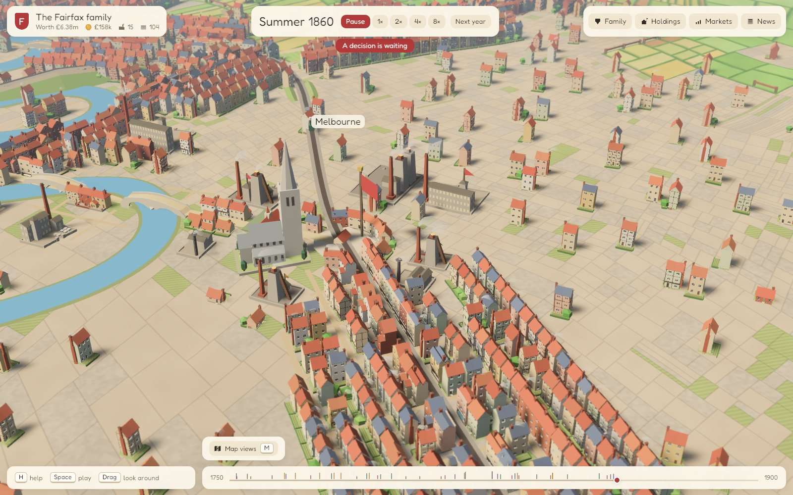
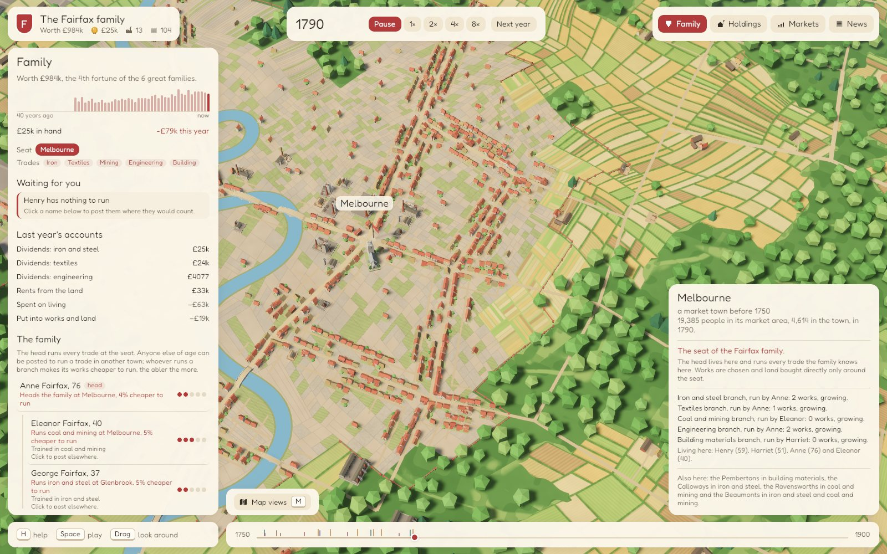
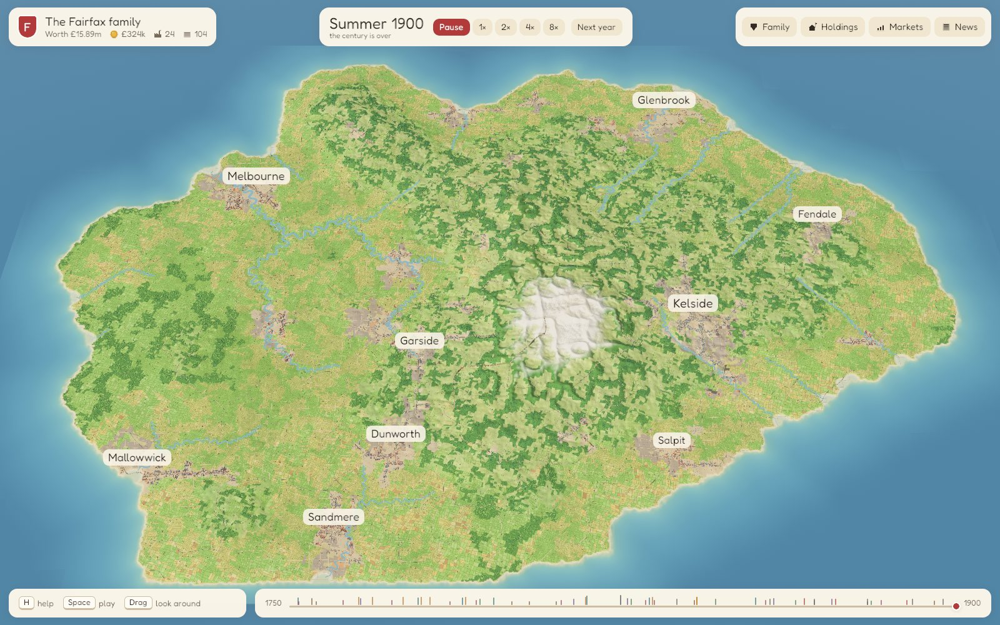

# Isolated State

An agent-based spatial economy on a procedural island, 1750 to 1900, and a game played on it: you are one family among six.

Nothing on the map is placed by hand. Households, landlords, investors and railway promoters act on the prices they can see, and the geography comes out of those choices: farm belts around market towns, ironworks moving onto the coalfields, roads where the carts go, railways where the roads are busiest. A separate observer watches the numbers and writes the news.

The name is von Thünen's: *Der isolierte Staat* (1826) is where the rings of land use around a market town were first worked out. Here they form on their own and then bend around rivers, roads and rails.



The simulation and the game are written in Rust, in three crates. The model began as a Python package, which is kept here as the reference the Rust was ported from. This is early work. The island runs, and a game can be played from 1750 to 1900 and saved, but the part where you decide what your family does is not much fun yet. [Where it stands](#where-it-stands), at the foot, says what is wrong with it today.

## Quick start

You need a recent Rust toolchain (the workspace is edition 2024; everything here was built with Rust 1.97). On Linux you also need `pkg-config`, `libwayland-dev` and `libxkbcommon-dev`. Windows and macOS need nothing extra.

```bash
cargo run -p isostate-viewer
```

The first build compiles Bevy and takes some minutes. Then the terminal says which island is being made and where the game is kept, and a few seconds later a window opens over your home town with a card. On island 7, the one you get unless you ask for another, you are the Fairfax family of Melbourne: seven people, £18k in hand and 104 squares of land, with five other great families already at work across the island.

- Click to begin. The first decision is waiting: the family's trade. Every choice in the game is from a short list that says what each option would mean. There are no sliders.
- The top bar shows the month and the year, "January 1751" to begin with, over a thin bar that fills as the month goes by. **Next month** plays one month and stops, and **To January** runs on to the year's turn. **Space** starts and stops the clock, and Up and Down change its speed, from Slow to Fastest. A game starts at Steady, a month a second, and at that the 150 years take half an hour of running; at Fastest they take 75 seconds.
- What you order at a year's turn happens at once. Later in the year it waits for the year's end, and the Family panel lists what waits.
- Drag to pan, right-drag to turn and tilt, and use the wheel to zoom. **H** shows every key.
- Click a square near your seat to see what could be built there, with its cost and the return it expects at today's prices. Click a town, a works or a field to ask about it.
- Children are trained at fourteen, and an apprentice teaches the family a new trade. Grown members can be posted to run your trades in other towns, where their branches build on their own.
- **1** to **4** open the Family, Holdings, Markets and News panels. **M** washes a map view over the ground: rent, market areas, the way to market, prices or wages.
- The game saves itself after every year and every order. Start it again and it offers to continue. `--new` starts afresh, and `--seed 11 --families 4` gives another island with fewer rivals.
- In 1900 a card says where you stand among the families.



That command builds in Cargo's dev profile, in which this workspace still optimises Bevy and the simulation (see `Cargo.toml`). Adding `--release` gives a fully optimised build and takes longer to compile. The keys, the clock and its speeds, the panels, the map views, saved games and every option are in [crates/isostate-viewer/README.md](crates/isostate-viewer/README.md).

## Other things to run

Everything below writes under `runs/`, which git ignores.

**The simulation from the command line**, under either set of rules (the next section says what they are). A run to 1900 takes 15 to 20 seconds.

```bash
cargo run -p isostate-core --release -- run --seed 7 --out runs/port7                             # the port of the Python model
cargo run -p isostate-core --release -- run --seed 7 --rules game --families 6 --out runs/game7  # what a game is played under
cargo run -p isostate-core --release -- run --seed 11 --regime commons --lite --out runs/seed11c # the commons scenario, without the map layers
```

Each writes `run.bin` (the whole run, in the format described below), `series_monthly.csv`, `events.json` (the news) and `params.json`. There are also `--end-year Y`, `--params FILE` and `--content FILE`; `cargo run -p isostate-core --release -- --help` prints the list.

**A recorded run in the viewer.** Give the viewer a `run.bin` and it plays it back instead of starting a game:

```bash
cargo run -p isostate-viewer -- runs/game7/run.bin
```

Space plays and pauses, Left and Right step a year, and a click asks about a works, a town or a square, with the sums that put each works where it is. There is no family to play in a recording. `runs/port7/run.bin` shows the island under the port's rules, which is a different history of the same land.

**A sweep of seeds.** `sweep` runs many islands side by side on their own threads and boils each run down to its stylised facts, some 320 of them under the game's rules: people, wages, towns, railways, works, land and the diggings, inventions, price swings and the news. With `--compare` it sets the result beside an earlier sweep, seed for seed.

```bash
cargo run -p isostate-core --release -- sweep --seeds 1-8 --rules port --families 6 --out runs/sweep-port
cargo run -p isostate-core --release -- sweep --seeds 1-8 --rules game --families 6 --out runs/sweep-game --compare runs/sweep-port
```

Each takes about a minute for eight islands, all eight running at once. It prints a table of every fact's mean across the seeds with the least and greatest beside it, and then the comparison, of which this is a little:

```text
now: game rules, 6 families (8 runs); then: port rules, 6 families (8 runs) in runs/sweep-port
seed for seed, on seeds 1 2 3 4 5 6 7 8
of the 245 facts both have, the seconds aside, 240 differ and 137 of those are starred
...
                                          now     then            change  up/down
  urban_share_1900                      0.422    0.255            +0.167      8/0  *
  real_wage_1900_vs_1750                 2.61     1.35             +1.26      8/0  *
  rail_km_1900                          2,261    1,072  +1,189 (+110.9%)      8/0  *
  works_1900                            747.2    6,973   -6,226 (-89.3%)      0/8  *
  price_swing_iron                      0.168    0.202   -0.034 (-16.7%)      1/7
```

`up/down` counts the islands on which the fact is greater now and those on which it is less. A star means every island now stands clear of every island then. It also writes `annual.csv`, `facts.csv`, `facts.json`, `summary.txt` and a `README.txt` saying how they were made. `--set key=v1,v2` sweeps any parameter by name. [docs/rules/README.md](docs/rules/README.md) explains the table and each fact.

**Pictures with no window.** The viewer can play a game and write pictures without opening a window. The picture at the top of this page was made with the first of these (and then saved as a JPEG); the second plays a whole game and writes twelve standard views of it (the island and the home town in 1750, 1800, 1850 and 1900, the town in winter, a street, the busiest works district) with an `index.html` to look at them in.

```bash
cargo run -p isostate-viewer -- --advance 110 --season 0.5 --view runs/melbourne-1860.png,,28.8,28.5,25,32,2.6,none
cargo run -p isostate-viewer -- --shots runs/shots
```

**The generators' lab.** Every house, works, church, bridge and tree is drawn by a plain function in `crates/isostate-gen`. The lab lays a contact sheet of them on bare ground in the game's own light, with no game, in two or three seconds:

```bash
cargo run -p isostate-viewer -- --lab list
cargo run -p isostate-viewer -- --lab cottages-eras --out runs/lab
```

**The tests.**

```bash
cargo test -p isostate-core --release    # 164 tests, four to six minutes once built; the golden test is among them
cargo test -p isostate-gen               # 116 tests, a few seconds
```

## Two sets of rules

The simulation runs under one of two sets of rules, and [docs/rules/README.md](docs/rules/README.md) is the page that explains them.

**The port** is a line-by-line port of the Python package. Every step was checked against the Python: deterministic steps agree to about 1e-14, and given Python's random numbers the stochastic steps make the same draws and reach the same decisions ([crates/isostate-core/PORTING.md](crates/isostate-core/PORTING.md)). It must stay exactly that, so nothing new is ever switched on under it. `crates/isostate-core/tests/golden.rs` runs seed 7 to 1900, once without families and once with six, and holds the monthly series and the news to stored hashes, byte for byte. It is what `isostate-core run` and `sweep` use unless told otherwise.

**The game's rules** are the port plus every mechanism the Python never had, each with a switch of its own, a page under `docs/rules/` and a sweep before and after. They are what a live game is played under, and `--rules game` picks them on the command line. Eleven mechanisms are in:

| Mechanism | What it does | Page |
|---|---|---|
| prices | Merchants mark a price by the stock they hold and stop buying into a glut, which ends two false cycles, in iron and on the farms. | [prices.md](docs/rules/prices.md) |
| engel | As a town grows richer its households spend less of each further shilling on food and warmth and more on comfort. | [engel.md](docs/rules/engel.md) |
| machines | Farms and quarries buy machinery where it pays, machines go on improving with the steel made, and converters and steel rails are made to pay. | [machines.md](docs/rules/machines.md) |
| harvest | Good years and bad on the farms, island-wide and by district, with the news of them. | [harvest.md](docs/rules/harvest.md) |
| chronicle | News that reads like a history: why each item is news, the few a decade worth keeping, and stories of towns and districts. | [chronicle.md](docs/rules/chronicle.md) |
| works | A life cycle for works. They grow where they stand and take land by their hands, so there are hundreds of works of every size, not thousands of small ones. | [works.md](docs/rules/works.md) |
| railways | Branch lines to towns and districts, each priced on the carting it saves, at several times the port's cost. | [railways.md](docs/rules/railways.md) |
| carting | Carting takes hands out of a town's labour supply, so cheaper carriage frees people for other work. | [carting.md](docs/rules/carting.md) |
| people | Births and deaths that answer to income, crowding and dearth, and towns that go on being founded where a market would save the most carting. | [people.md](docs/rules/people.md) |
| towns | A town keeps the ground it builds on and grows outward from it along its roads. | [towns.md](docs/rules/towns.md) |
| mines | A quarry, pit or mine is a pit head with the lease of the deposit round it. It pays a royalty and takes little of the surface, so the diggings hold a few cells of the island and not a fifth of it. | [mines.md](docs/rules/mines.md) |

Families are older than this convention. They are off under both sets of rules until a run says how many there are: the viewer asks for six, and `--families 6` does it on the command line ([crates/isostate-core/FAMILIES.md](crates/isostate-core/FAMILIES.md)).

What the two give, as means over islands 1 to 8 with six families, from the two sweeps above as run on 12 November 2026:

| | the port | the game's rules |
|---|---|---|
| People in 1900 | 683 thousand | 720 thousand |
| Share of people living in towns, 1750 and 1900 | 0.26 and 0.26 | 0.22 and 0.42 |
| What a wage buys in 1800, 1850 and 1900 (1750 = 1) | 1.31, 1.35, 1.35 | 1.62, 1.93, 2.61 |
| Works standing in 1900 | 6,973 | 747 |
| The middling works of 1900, in its trade's usual size | 0.46 | 6.0 |
| Cells of town ground, 1750 and 1900 | 69 and 77 | 64 and 323 |
| Cells of works ground in 1900 | 981 | 200 |
| Land under quarries, pits and mines in 1900, in cells' worth | 1,188 | 9 |
| Railway in 1850, 1870 and 1900 | 1,057, 1,071 and 1,072 km | 1,239, 1,853 and 2,261 km |
| The last town founded | 1802 | 1844 |
| Converter steel's share of steel in 1880 | none | 0.84 |
| News items in a run | 1,485 | 926 |

## How the model works

This is the model the two sets of rules share. Where the game's rules do something else, a note in brackets says so.

**Monthly.** Each town is a market. Households and landlords split their budgets across six needs (food, warmth, shelter, clothing, implements, comfort) with a linear expenditure system: subsistence first, then fixed shares of what is left. (The game's shares shift with income.) Each need can be met by any good that has the property, at that good's efficiency, chosen by a logit on price per unit of service. That is the "no hard walls" rule: a little steel is bought as a better tool long before anyone rolls steel rails, so new goods always have some market. Wages clear each town's labour market by bisection. Land produces with Cobb-Douglas technology on the cell's share of land; firms use fixed-coefficient methods with learning curves. Prices move with inventories and with the flow imbalance, merchants take a spread, goods move between towns where price gaps beat the carting cost, and the money stock is checked every month against what was issued. (In the game merchants set prices from the stock they hold, the harvest varies, and the men who do the carting are not there for other work.)

**Yearly.** Every cell's land is shared between farming, grazing, forestry, quarrying, clay, iron and coal in proportion to each use's bid raised to `1/theta`, adjusting part of the way each year. Bids are what the land earns at its market after carting, which is where the von Thünen rings come from. (In the game the four kinds of digging do not bid for the surface. Each quarry, pit or mine is a working: a pit head with the lease of the deposit within 4 km of it, paying a royalty to whoever owns the land it works under.) Towns grow outward by path cost. (In the game a town keeps its ground and takes its best free neighbour when it is full.) Investors in each town price candidate sites for every method they know and build where the return clears a hurdle; each firm keeps the sums that justified it. (In the game a works that earns its keep grows where it stands, and each trade in each town has a year's room for new capacity.) Roads upgrade where traffic is heavy. After the locomotive is invented, promoters raise money for the busiest town pairs and buy rails as they build, then add mineral lines. (In the game they go on to branch lines, each priced on the carting it would save.) Population grows with real income and moves toward better wages; new towns appear where work grows up far from any market. (Under the port the growth sits at its cap in nearly every year; in the game it answers to income, crowding and dearth.)

**Inventions.** No tech tree. Each method has thresholds in cumulative output of what it combines (coke smelting needs a lot of coal and iron handled; powered mills need machinery and cloth), expressed partly as multiples of 1750 output. Discovery is a hazard that rises steeply as the thresholds are approached, and the place it happens is drawn in proportion to how much of the ingredients each town handles. Know-how then diffuses along trade costs and productivity follows Wright's law.

**The observer.** It reads series and writes events: crossings (a new method passes half of output), doublings and orders of magnitude, cities passing round numbers, railway milestones, and steepness. Steepness is a year whose growth is far outside its trailing trend (a z-score on log growth), labelled by the quadrant of price and quantity: boom, glut, shortage or slump. Downturns run on two clocks: a live alarm when output falls, and a dated verdict in hindsight once the recovery is complete. The simulation never reads what the observer writes. (In the game the chronicle marks the few items of each decade that a history would keep, and tells the stories of towns and districts.)

**Families.** With families switched on, six families own works and land and grow through their people: children trained at fourteen, grown members posted to run a trade in a town, branches that build on their own. They act through the same prices and bids as everyone else, and every flow of money is a transfer the monthly check counts. One of the six is the player's; the others play by the same rules. None of this is in the Python.



The island is 120 by 84 cells of 2 km. The content of the economy is one file, `data/content.toml`: sixteen goods, six needs, seven uses of the land, sixteen production methods, five further inventions (steam pumping, wagonways, railways, improved husbandry, farm machinery) and all the text. The game's rules add to it in code (`game_content`), never in that file, which is the Python's.

## The export format

`record.pack` in the Python and `record::pack` in the Rust write the same binary container, one per run: a little-endian `uint32` header length (including padding), a JSON header, then typed arrays aligned to 8 bytes. The header has names, events, firm records with their reasons, towns, series names and an `arrays` table of `{name, dtype, shape, offset, nbytes}`. Map layers are stored layer-major (`[year, cell]`) so years of the same layer sit together and compress well. The web viewer reads it with `DecompressionStream` and typed-array views, with no parsing of the bulk data; the 3D viewer reads the same file in `crates/isostate-viewer/src/replay.rs`. A run under the game's rules adds three layers for the towns (the year each cell joined its town, its residents, and the share of each cell under works) and a table of the workings of each year (where each pit head stands, its hands, what it raised and its spoil heap).

A saved game is something else: the seed, the rules and a log of the player's orders, played again from 1750 when it is loaded (`crates/isostate-core/src/save.rs`).

## Scenarios

`rent_regime="landlords"` (default): land rent goes to landlords, who spend more of it on shelter, services and comfort, mostly in town.
`rent_regime="commons"`: the same rent is paid out to every household as an equal dividend.

On the command line it is `--regime commons`, in the Python and the Rust alike. A sweep runs both on many islands at once:

```bash
cargo run -p isostate-core --release -- sweep --seeds 1-8 --rules game --families 6 --set rent_regime=landlords,commons --out runs/sweep-regimes
```

As run on 12 November 2026, one of its sixteen runs fails: island 3 under the commons stops in 1762, when the monthly check finds that money is not conserved. The sweep says so, finishes the other fifteen and ends with an error. The fault came in with the mines (the same run passes with `--set mines.enabled=false`) and is not mended yet. On the seven islands that finished under both, the commons islands end the century with more people (830 thousand against 719 thousand), fewer famine years (0.9 a run against 2.0), a lower wage (2.25 times 1750's against 2.65, though a commons household also has its dividend, which the wage does not count) and much less railway (1,310 km against 2,278). Nobody has yet traced why, so take these as what the model does and not as findings.

## Layout

```
Cargo.toml              the Rust workspace: the three crates under crates/
crates/isostate-core/   the simulation, in Rust: a library and the isostate-core command
  src/                  one module per Python module (world, transport, econ, land, firms, tech, people,
                        rail, observer, record, sim, cli), then what the Python never had: families and
                        the live API (families.rs, live.rs), saved games (save.rs), the sweep and its
                        facts (sweep.rs, facts.rs), and a module for each mechanism of the game's rules
  tests/                the golden test, the step-by-step parity tests, and tests for each mechanism
  examples/             scripted players (bots.rs), censuses of works, towns and mines, timing, probes
  parity/               Python scripts that dump the Python's state for the parity tests
  FAMILIES.md           how families work, the live API, and what the scripted players found
  PORTING.md            the port: the mapping, every deviation, the parity tables, oddities in the Python
crates/isostate-gen/    the generators: plain functions that turn what the simulation knows into
                        houses, works, churches, bridges and trees (no Bevy; its README says how)
crates/isostate-viewer/ the game and the 3D viewer, in Bevy 0.20 (its README has the keys, the options
                        and how the picture is made)
  src/                  the ground and sea shaders, rivers, fields, railways, the towns' layout,
                        the interface, map views, charts, saved games, the standard shots and the lab
  assets/look.toml      every colour of the scenery, the light and the lens, in one file
data/content.toml       goods, needs, sectors, production methods, inventions, discovery thresholds, all text
docs/                   the devlog, the backlog, the art plan, and the rules, designs and probes (below)
docs/shots/             the pictures the documents show
PLAN.md                 the plan, in three stages

isostate/               the original Python model, kept as the reference
  params.py             every tunable number, one plain dict
  content.py, names.py  reading data/content.toml; names for towns, works and people
  world.py              island generation: elevation, rivers, soils, ore, coal, town sites
  transport.py          cost graph (terrain, roads, rivers, sea, rail), Dijkstra fields, traffic
  econ.py               the monthly step: demand, wages, production, prices, trade, money
  land.py               yearly land allocation by bid rent, urban growth
  firms.py              site evaluation, entry, expansion, closure, the "why here" records
  tech.py               discovery from cumulative use, diffusion along trade routes
  people.py             growth, migration, new towns
  rail.py               railway promotion and construction
  observer.py           series registry and the news detectors (never read by the sim)
  record.py             yearly snapshots and the binary export
  sim.py                init_state, yearly, run
  cli.py                the Python's commands
viewer/index.html       the single-file web viewer; record.build_html embeds runs into it
dist/                   where the Python writes the web viewer's pages (git ignores them)
tests/test_sim.py       the Python's tests: money conservation, determinism, rent gradient, no hard walls,
                        export round trip
notebooks/explore.py    notebook-style cells for analysis
requirements.txt, pyproject.toml   the Python package's dependencies
```

## The Python original

The model was first written in Python, and the Rust core is a port of it. The Python stays in the repository, unchanged, as the reference: the port's rules are held to it, and the parity tests compare the two step by step. It is also still the only thing that builds the web viewer, a single self-contained page with the runs embedded in it.

```bash
pip install -r requirements.txt          # numpy, scipy, numba, tqdm, and pytest and pandas for the tests and the notebook
python -m isostate build                 # runs both scenarios and writes dist/isolated_state.html
python -m pytest -q
```

Open `dist/isolated_state.html` in any recent browser, phone included. Other commands:

```bash
python -m isostate run --seed 11 --regime landlords --out runs/seed11      # one run, saved as run.bin + CSV + JSON
python -m isostate run --seed 11 --regime commons --out runs/seed11c --lite # charts-only comparison run
python -m isostate html runs/seed11 runs/seed11c --out dist/seed11.html    # first full run is the map, the rest are compared in charts
```

`python -m isostate html` reads a `run.bin` written by the Rust as well. For poking at things interactively, `notebooks/explore.py` is a set of `# %%` cells. A Python run takes 80 to 120 seconds, by the machine, where the Rust takes about 20 (PORTING.md, "Timing"), and a seed gives a different island in Python than in Rust, because the random streams differ; across 16 seeds the two agree within chance.

## The documents

- [PLAN.md](PLAN.md): the plan, in three stages: a lab, a visual tool, a game.
- [docs/DEVLOG.md](docs/DEVLOG.md): what happened, newest first. Its newest entry is the best account of what exists.
- [docs/BACKLOG.md](docs/BACKLOG.md): what is waiting, what is being done and why in that order. The pages under `docs/backlog/` hold what helpers and reviewers found along the way and what waits on a decision.
- [docs/rules/](docs/rules/README.md): the port and the game's rules, the golden test, the sweep and its facts, and a page for each mechanism with its numbers, what the sweeps showed and what worries us.
- [docs/designs/](docs/designs/README.md): designs worked out and argued over but not yet built. Today, a deeper production tree.
- [docs/probes/](docs/probes/README.md): diagnoses of the simulation, each measured on eight or more islands with a rough prototype of a cure. The game's first mechanisms were built from five of them; the sixth, on what a works holds and on combined works, waits in the backlog. Kept as written.
- [docs/ART.md](docs/ART.md): the plan for the look: generators and not asset files, and change you can see happen.
- [crates/isostate-viewer/README.md](crates/isostate-viewer/README.md): playing, the keys, every option, saved games, and how the picture is made.
- [crates/isostate-gen/README.md](crates/isostate-gen/README.md): what a generator is, the kits the houses and works are built from, and how to add one.
- [crates/isostate-core/FAMILIES.md](crates/isostate-core/FAMILIES.md): families, the live API, and what scripted players found.
- [crates/isostate-core/PORTING.md](crates/isostate-core/PORTING.md): how the Rust was ported from the Python and checked against it.

## Where it stands

The numbers below are means over islands 1 to 8 with six families, from the sweeps above as run on 12 November 2026, unless a page is named.

**What exists.** The simulation in Rust under both sets of rules, with a sweep to measure a change on many islands. A game that can be played through the century and saved: decisions, a seat, branches, works built and land bought, four panels, five map views, charts, the news. A picture drawn entirely by code, with no model or image files, from the whole island down to a street. The work now in hand is listed in the backlog: canals, a second island generator with real rivers and lakes, books of account, a deeper production tree, and towns and works drawn better.

**The game.**

- The core loop is not fun yet, and it is set aside for thinking of its own. Scripted players show the shape of it: buying land beats building works on all four islands they were tried on, a family that takes every default ends fourth of six on three islands of four, and a player who founds a works every year loses most of them (FAMILIES.md, `docs/rules/works.md`, `docs/rules/towns.md`).
- A saved game is its orders played again, so it does not survive a change to the simulation, and loading a whole century takes about 23 seconds before the window opens.
- The clock tells the month since 12 November, and a game starts at a month a second, but the game is still played by the year: an order given in the middle of a year waits for its end, and the decisions come at a year's turn, so their cards sit over the island in January.
- There is no title screen and no sound.
- The politics half of the game is not started.

**The economy under the game's rules.**

- Growth comes early and then stops. Output per head peaks in 1882 on average and falls after. The cause is not proven.
- The share of people in towns reaches 0.42 by 1900. The plan asks for a half.
- There is a building cycle nobody chose: a town's mills order a whole year's room for new capacity at once and then next to nothing for two or three years, and timber trebles when they do (`docs/rules/works.md`). The worst year for what a wage buys is 15 per cent down.
- Tools run short when farm machinery arrives: in their dearest year they cost 5.8 times what they do in a middling one (`docs/rules/works.md`, six islands, before the mines).
- There are 2.2 famine years in a run.
- The steel rail hardly arrives: it is 3 per cent of rails in 1890, and on one island of eight it is never made. Cheaper ore since the mines has made it worse (`docs/rules/mines.md`).
- The railway age begins anywhere from 1805 to 1850, so in 1850 one island has 25 km of line and another 1,834. Nobody collects a railway's fares, and nobody pays for a road or a bridge.
- Quarrymen are one hand in seven by 1900, and the island takes some twenty units of stone a head a year, which is far too much if a unit is about a ton. Households buy shelter as raw stone, because the masons, bricklayers and carpenters who belong between the quarry and the house are designed and not yet built (`docs/rules/mines.md`, "Why quarrying takes so many hands").
- Under the commons scenario one island of eight fails the monthly money check in 1762, since the mines came in (see Scenarios).
- Most of the mechanisms' numbers were set on a few islands and never searched. Eight islands is a small sample, and a single year's wage misleads: read twenty-year means before believing a row (`docs/rules/towns.md`).
- No foreign trade and no government, and money grows at a fixed rate.
- Run past 1900, the island goes Malthusian, because there is no demographic transition and no technology after steel. On island 7 with `--end-year 2050` the people grow from 740 thousand in 1900 to 4.3 million, and what a wage buys falls from 3.0 times 1750's to three quarters of what it bought in 1750.

**The port's rules.** These are the Python model's own weaknesses. The port keeps them on purpose, and the game's rules are the answer to most. On eight islands without families (`docs/rules/README.md`, "What the port's baseline says"):

- Towns do not pull people in: the share living in towns is 0.26 in 1750 and 0.24 in 1900.
- What a wage buys rises by a third before 1800 and then stops.
- The railway is built in a rush and stops at about 1,020 km.
- Works stay small and many: 4,500 by 1900, and 7,000 with six families.
- Iron and rail prices swing two and a half times as hard as grain and cloth, and farm employment zigzags with a period of two or three years.
- The converter is found and hardly ever built, so cheap steel never arrives. No town is founded after about 1800.
- People multiply at the growth cap in nearly every year, whatever their standard of living.
- Quarries, pits and mines take a fifth of the land: 1,190 cells' worth by 1900, nearly as much as the farms.
- PORTING.md lists ten things in the Python that look like bugs. The port does what the Python does in each.

**The picture and the interface.**

- A town of 1900 is drawn as a wide pale ground with houses strung along some streets and dotted thinly elsewhere, and tall houses stand alone outside the middle. Towns drawn from the ground they keep are in hand.
- A quarry, pit or mine is drawn as one small pit on its cell, a stand-in. Pit heads, spoil heaps to their size, and idle or abandoned workings are not drawn yet (`docs/rules/mines.md`, "What the viewer is given").
- The roads and bridges are the viewer's own invention, so a road down a valley crosses its river again and again, and a cart can pass through a bridge.
- The railways climb like railways since 12 November, and some of it is still wrong: on island 7 in 1900 four churches have the line hard against their yard, eighteen curves are tighter than a train should take, roads drape over the banks with no bridge or crossing, and sidings are plain ribbons (`docs/DEVLOG.md`).
- A works that closes vanishes at once. Small works of different kinds are hard to tell apart from the distance the game is played at.
- A year's scenery is rebuilt whole, off the main thread, and handed over in one go. Where that stalls the picture has been measured and a smoother hand-over designed; it is not built.
- A recorded run of a game replays without its owners, so with no pennants or fences.

**The code and its tests.**

- The golden hashes were taken on Windows with the MSVC toolchain. Another system's maths library may round a last digit the other way, and the test has not been tried on one.
- The golden test watches the economy and not the map: a change to what `run.bin` records for the viewer passes it.
- The parity tests need fixtures dumped from the Python, about 3 GB, which are not in the repository. Without them they pass and check nothing, and the golden test stands alone.

[docs/BACKLOG.md](docs/BACKLOG.md) has the order of work, and [docs/backlog/found-along-the-way.md](docs/backlog/found-along-the-way.md) the long list these were drawn from. [PLAN.md](PLAN.md) says where it is all meant to go.
