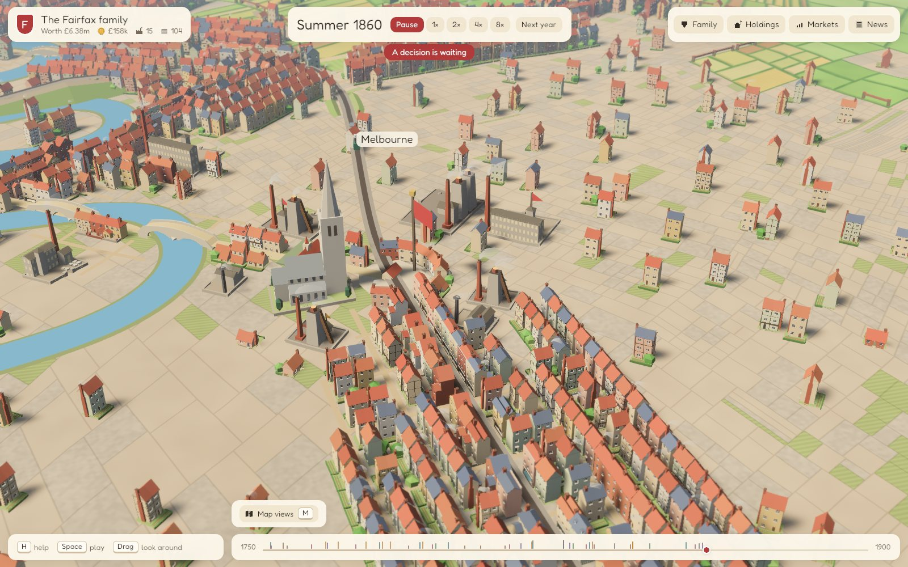

# isostate-viewer

The game, and a 3D viewer for Isolated State runs, in Bevy 0.20. It draws the island as a small diorama and plays it from 1750 to 1900 on a clock that tells the month; the map itself is redrawn once a year. It either runs the simulation live, with you playing one of the island's great families, or plays back a `run.bin` written by the Python package or by the Rust core.



## Running

```bash
cargo run -p isostate-viewer --release                                    # a sandbox on island 7: watch the island and change it by hand
cargo run -p isostate-viewer --release -- --family                        # the family game on island 7 with six families: a new one, or the one you left
cargo run -p isostate-viewer --release -- --family --new                  # a new family game, whatever is saved
cargo run -p isostate-viewer --release -- --seed 11 --families 4          # another island, fewer families
cargo run -p isostate-viewer --release -- --new --to 1900                 # a new game that ends in 1900, as every game did before
cargo run -p isostate-viewer --release -- --old-land                      # a new game on the old island, as every game was before 19 November 2026 (see The new land)
cargo run -p isostate-core --release -- run --seed 7 --out runs/rust7     # record a run (or use the Python package)
cargo run -p isostate-viewer --release -- runs/rust7/run.bin              # and watch it
```

A new game is played to 2050, or to the year `--to YEAR` gives (1900 to 2050). The last year is chosen when the game is begun and kept in its save, so a game gone on with is played to its own last year whatever `--to` says, and a save made before there was a choice is a game to 1900 (`docs/rules/longrun.md`, "A game past 1900"). Past 1900 the island is the hungry island of the long run's first stage: people go on multiplying and what a wage buys falls, since nothing after steel has been written yet; that is expected until the later stages of the run to 2050 land. The standard shots (`--shots`) always play a game to 1900.

**Which game opens.** A start with somebody at the window and no run named opens a sandbox (`docs/designs/sandbox.md`): nobody plays a family, a tray of tools under the clock changes the island by hand, and the card at the top left is the island's ("Island 7", with its people and its works standing in the year on the clock), with the tabs Hand, Rules, Markets, News and Families (keys 1 to 5) and the hand's blue-black ink as the accent. A sandbox is kept in its island's session, `sandbox/island-7-families-6.json` in the saved games' folder, never in the island's own saved game: a plain start goes on with the session there, behind a short card (Go on, or Begin again), and any other start (`--new`, `--seed`, `--advance`, `--load`, `--demo`) makes the island anew in the session's place and sets the session before it aside (see Saved games). `--family` opens the family game instead: its own card, the tabs Family, Holdings, Markets and News, its colour, and with nothing else asked for the island's saved family game is gone on with, exactly as a plain start did before. A start nobody is at (pictures, `--describe`, `--class-map`, a script) and `--demo`, whose orders are the family's, play the family game unless `--sandbox` is given, so the standard pictures and the scripted checks are as they were. `--family` and `--sandbox` together are refused in a sentence. `--load FILE` opens the file in whichever kind of game was asked for. A recorded run is neither.

The first build compiles Bevy and takes a while. On Linux you need `pkg-config`, `libwayland-dev` and `libxkbcommon-dev` to build; Windows and macOS need nothing extra. Other options: `--year 1846` opens a replay on a year, `--advance 20` starts a game twenty years in, `--size 1600x1000` sets the window, `--at 31.5,29.5` points the camera at a spot in map cells, `--yaw 25`, `--pitch 38` and `--dist 10` turn it, tilt it and set it back (degrees, degrees above the horizon, and map cells; a game opens looking north at a tilt of 52 from a distance of 14 over the home town, a replay over the whole island), `--overlay rent` opens on a map view, `--no-tilt` starts without the miniature focus, `--look FILE` lays a look file of your own over the standard one (`assets/look.toml`: every colour of the scenery, the light and the lens; a partial file is enough, and a misspelt key is refused with the nearest name), and `--load FILE` and `--save FILE` name a saved game (see Saved games). `--help` lists every option, those of the standard shots (`--shots`) and of the generators' lab (`--lab`) among them. An option that is not one, an option with no value after it, or a value that cannot be read (`--advance 3O`, `--season summer`, `--overlay rents`) stops the viewer with the reason and the list (exit code 2), rather than running as if it had not been given. A `run.bin` that is cut short or damaged is refused with a message naming the file and the array; the "make a run first" hint follows only a file that is not there.

| Key or mouse | Does |
|---|---|
| Space | start or stop the clock (a replay starts again from 1750 at the end) |
| Right (or .) | in a game at the present: play one month, then stop. In the past, and in a replay: one year on |
| Page Up | in a game at the present: play on to the year's turn, in January, then stop. In the past, and in a replay: ten years on |
| Left (or ,) | back to the turn the year began at, and from a turn to the one before (Page Down: ten years back) |
| Up / Down | one speed faster or slower; or click Pause, Slow, Steady, Brisk, Fast or Fastest (a speed's button also starts the clock) |
| Left drag, WASD | pan |
| Right drag, Q / E | turn and tilt |
| Wheel, R / F | zoom |
| Click | ask about a works, a town or a square |
| 1 2 3 4 | the Family, Holdings, Markets and News panels (in a sandbox 1 to 5: Hand, Rules, Markets, News, Families) |
| M | map views: rent, markets, reach, prices, made here, wages, town growth, residents, deposits, then the plain map (Shift+M back) |
| G | the next good, when prices or where a good is made are mapped, or the next kind of ground on the deposits (Shift+G back) |
| H | every key |
| Esc | close the note about what was clicked, put off a decision, or close the card at the century's end |
| T | tilt-shift (miniature focus) on and off |
| F3 | the frame strip: the last 240 frames as bars at the bottom left, green under 16.7 ms, amber to 33, red beyond, a dark tick under a frame a year arrived in and a pale one under a frame part of a year's scenery went to the card in; under it the middle frame, the longest and how many were over 33 (H's card does not list it yet) |

While the opening card, a decision or the card at the century's end is up, the clock stands still and the other keys wait. Any key or a click closes the opening card without starting the clock (Alt, Shift, Ctrl and Print Screen do not).

## Playing

You are a family among six. You start with some cash, land around your seat town and a handful of relations; the other families already hold land and works across the island. Every choice is from a short list, never an amount to set.

The simulation runs a month at a time, and the top bar shows the month and the year ("March 1784") over a thin bar that fills as the month goes by. The simulation has nothing shorter than a month, so the bar is only the clock's place in it, and is never called a week or a day. The map is redrawn once a year: during 1784 it shows the island as 1783 left it. A new game opens on January 1751, with 1750 played. Stopped on the turn of a year gone by (or on any turn of a replay), at the end of the game and in every still, the bar shows the year alone, which is the year the map is of.

| Speed | Pace | 1750 to 1900 |
|---|---|---|
| Slow | a month every two seconds | 1 hour |
| Steady (a game starts here) | a month a second | 30 minutes |
| Brisk | a season a second | 10 minutes |
| Fast (a recorded run starts here) | a year a second | 2 minutes 30 seconds |
| Fastest | two years a second | 75 seconds |

Those are the times if nothing stops the clock and the simulation keeps up; a decision stops it. When a game starts, the terminal prints each speed with how long the years still to come would take.

Space starts and stops the clock, and a speed's button starts it at that speed. In a game, **Next month** plays one month and stops, and **To January** runs on to the year's turn and stops there; looking back, the two step through the months already played. The line under the date says what the clock is doing: its pace while it runs ("a month a second"), and when it is stopped "the year's turn", "orders wait for January 1785", "looking back", "the year is turning…" or "the last year is over".

- **Decisions** come as cards and stop the clock: the family's first trade, what each child learns at fourteen (an apprenticeship in a trade, which the family then knows, or university), who heads the family when a head dies. Each option says what it would mean, the default is marked, and Decide later leaves it for the badge that hangs under the clock ("A decision is waiting"). Unanswered, the default is taken at the end of the next year.
- **The seat** is where the head lives. Only there do you build works yourself (click a square in the present to see what could be built, with its cost, its expected return at today's prices and how deep its market is) and buy land. The head runs every trade the family knows at the seat. Click another town to move the seat there at the year end; its square flies your flag.
- **Branches.** Post a grown member to run one of your trades in another town (from their card in the Family panel, which suggests where they would count, or from the town's note). A branch makes its works cheaper to run, the abler the runner the more, and grows on its own: a works a year, or land for estates. In Holdings, set each branch to Grow, Hold or Wind down. Works with nobody of the family over them pay a fifth of their profit to a hired manager.
- **The present and orders.** Orders (Build, Buy, Move the seat, a posting, a branch's stance, answering a decision) are given in the present, the year in progress. The months go by one at a time, but nothing you order touches the island between a year's first month and its last, and the game says when each order will happen:
  - At a year's turn, before January is played, an order is carried out at once.
  - Later in the year an order is tried against the island as it stands, with what already waits. If it could not be done today it is refused at once; otherwise it waits.
  - Word to the family (a decision answered, a posting, a branch's stance, the seat) takes effect when December has been played, before the year's books are closed, which is where a decision's default would be taken.
  - Works are begun and land is bought at the turn, in January, if the money is there then.
  - What waits is listed at the top of the Family panel under "Waiting for the year's end", each with Take back, and the cash it would take is shown as promised. At the turn a toast says what became of each.
  - For the moment a year is turning (December has been asked for, and the year's end comes with it) the order buttons go unlit, and a decision card opened then says "The year is turning…" until the year arrives. Pause when the new year has already been worked out and the clock moves on to its January.
- **The past.** Step back with Left or the timeline and the panels show the past; the line under the date says "looking back". The order panel offers "Back to" the present ("Back to March 1784"), and the Family and Holdings panels and the family's card in the top bar say which year their figures are of ("The Fairfax family in 1780"), since the family is kept only as it stands today.
- **The Family panel** has the orders that wait for the year's end, your worth over the years, last year's accounts, anything waiting for you (decisions, members with nothing to run), the family tree, and the great families, each of which can be opened to see its head, trades and branches. Holdings lists the branches and works; click a works to fly to it. Each of your works flies a pennant in the family colour from its highest gable, and your open land is fenced along its hedges in timber with post caps in that colour.

- **News.** News is dated by its month, in the toasts and in the News panel ("Turning point · October 1751"), and a tick on the timeline sits where the knob stands on that date. In a live game a month's own news (a railway opened) arrives in its month; the rest of a year's news arrives at the year's end and goes up then, dated as it is. The panel lists the newest 120 items and says so at its foot ("The newest 120 of 457 are listed."); Show more adds 120.
- **Seasons.** The fields, the sun, the rivers, the trees and the date agree wherever the top bar shows a month and a year takes twelve seconds or more: at Slow, at Steady, and whenever the clock is stopped on a month. Faster than that the seasons keep a calm round of their own, 24 seconds long, so the broadleaf woods are green, gold, bare and green again once a round at Brisk and at Fastest alike. Where the bar shows a year alone, a stopped clock holds the season where it is. The season never jumps: a clock stopped after running fast glides to its date in about a second and a half. The top bar names the season only when one is held with `--season` or a view's season ("Summer 1860").

How families work inside the economy, and what the scripted test players found, is in `crates/isostate-core/FAMILIES.md`.

### Map views

Press **M** to step through nine views washed over the ground (Shift+M steps back), or click a chip on the legend card at the bottom of the screen. On the plain map the card shrinks to a "Map views" button, which brings back the view last used.

| View | What it shows | Scale |
|---|---|---|
| Rent | what the ground of each square earns its owners in a year | by ratio |
| Markets | the country that trades in each town's market, with ink lines where one town's pull gives way to the next | none: six soft tints, no two neighbours alike |
| Reach | how far each square is from the market it trades in, as kilometres of flat open country | evenly, from "at the market" |
| Prices | the year's average price of one good in each square's market town; the note names the cheapest and the dearest town | evenly |
| Made here | how much of one good was made in the year: a good of the land (grain, wool, timber, stone, clay, ore, coal) square by square, a good of the works over each town's own ground | by ratio |
| Wages | what a month's work pays in each town, across its market area | evenly |
| Town growth | the year each square of town ground joined its town | evenly; over the whole run, from the oldest ground the record dates to the run's last year, the same in every year |
| Residents | how many people live on each square of town ground | by ratio |
| Deposits | what the ground holds, one kind at a time: coal, iron ore, clay, stone, the standing timber, the soil and the grazing | evenly, from "none" |

Town growth and residents need a record that holds the towns' ground, and Made here one that kept the books of account; a run under the game's rules has both, and on a run under the port's rules they say so and leave the land blank.

**How the colours are spread.** Every view that colours by a number has three chips on its card, "Colours from" This year, 30 years and Whole run, and the one lit says which is in use. The choice is kept for each view while the viewer is open (`src/ranges.rs`).

- *This year*: the palest and the darkest tints stand at the least and the greatest of what the view shows this year.
- *30 years*, which every view opens on but Town growth and Deposits: the least and greatest of the last thirty years. The two ends glide: each year an end goes a fifth of the way (`ranges::PACE`) from where it stood toward where the thirty years would put it, so a wild year coming into the window, or leaving it thirty years on, moves the colours a little each year and never at a jump. Looking back at an earlier year shows the ends as they stood then.
- *Whole run*: the least and greatest of every year played so far, or of the whole record in a recorded run. Town growth and Deposits open on it, since their scales are their own: the run's years, and the ground as it lay before anything was worked.

The least and the greatest are never one odd town's or square's. They are taken a little inside the extremes: the twentieth part of the towns or squares at either end is left out (`ranges::LOW`, `ranges::HIGH`), at least one at each end, so the one dear market of twenty does not squeeze the other nineteen into two tints; with fewer than five the ends are the least and the greatest. What lies beyond the ends is drawn in the end's tint, and the card says "and below" and "and above" under them. Along the bar stand three to six round figures (£1.00, £1.20, £1.40; 10, 100, 1,000 on a scale by ratio), each at its place with a fine mark on the bar. A year's ends are reckoned once and kept: a year that arrives is reckoned in its frame, which costs a few tenths of a millisecond, and when a view is opened on a run of many years (30 years and Whole run want every year before) the years are reckoned off the main thread, the year's own ends standing in until they come.

**Made here** reads the books of account, which keep what each town made of each good in a year, its land and its works together. The record keeps no figure of a farm square by square, so a crop, wool and timber are each town's figure shared among the squares of its market by how much of each square the record gives to that use and how rich its ground is for it (the soil, the grazing, the timber standing). A pit's, a quarry's and a mine's figure is its own: each working with what it raised, on its pit head's square. A good of the works is each town's figure laid over the town's own ground. A good nobody made that year says so, in place of a map of nothing.

**Deposits** shows the ground's fields as the core keeps them, from 0 to 1, and in a game how much of each worked deposit is left: the richness the hands meet there now, which falls as it is worked (the core's `docs/rules/mines.md`, E), with the squares that have been worked ruled round in ink and the note saying what share of the island's first deposit is left. The standing timber is the woods' cover as each year ends. A recorded run keeps neither, and says so: its deposits are drawn as they lay at the start, and its timber as what the ground could carry where it is wood. Nothing can be changed here yet.

The price and made maps start with grain and the deposits with coal. **G** shows the next good or kind and Shift+G the one before, as do Back and Next on the card; opening a good in the Markets panel sets the maps to that good too. The legend card gives the year, one sentence on what is shown, and the scale. Click a square with a view on and the inspector adds the view's value there. Trees are hidden while a view is on, and the views that go by market towns name every town. Nothing is shown that the record does not hold: rent is stored on a scale that stops at 1000 a month, so the middle of a town reads "or more".

In a live game, where the top bar shows a month, the price and wage maps show the last finished month in place of the year's average, and the legend and the inspector name it ("The price of grain in March 1751"). What the towns paid and charged month by month is held only for the months played since the game was opened; before that, and in a recorded run, the two maps show the year's average. The other views are the year's, as the map is.

### Charts

The Markets panel (key **3**) has three halves, chosen by chips at the top:

- **Goods**: the prices against 1750. Click a good's row for its history underneath: price in ink (left scale) and how much is made a month in the family's colour (right scale). Click again to close it.
- **The island**: people, what a wage buys (1750 = 1), what is made a head (1750 = 1), the share living in towns, railway length, and the number of works and shops. What a wage buys is the linked wage (`real_wage_linked`, `docs/rules/measures.md`) over its own 1750 figure, by the month each month over that figure, and in a run without it the chained wage (`real_wage_chained`); a run with neither (the port's rules) keeps the fixed basket of 1750 under the words "What a wage buys of 1750's basket", which is wrong after the middle of the 1800s. What is made a head is `made_linked` over the people, against its 1750 figure, and only a run that keeps it shows it (in 2040 on island 7, 27.9 against a wage of 15.2). Last, in a run under the game's rules since 20 November 2026, the **people by age, reckoned** (`src/ages_chart.rs`, `docs/rules/ages.md`): a pyramid of the seventeen five-year groups in the year on the clock (the last year closed, in the months of one still open), under 15 warm, 15 to 64 cool and over 64 green, with the three shares over it, and the shares under 15 and over 64 year by year; `print` on this half adds an `ages:` line with the year, the people and the three shares to four places. Under it, from 1900 and only in a run that keeps it, **the state's purse** (`src/purse_chart.rs`, `docs/rules/state.md`): the rate on pay, schools over income and pensions over income as three lines on one scale from 1900, with their figures in the year on the clock and the months of spending the treasury holds; `print` adds a `purse:` line with the four figures.
- **Work** (`src/work_charts.rs`): the run to 2050's island, year by year, in six charts with several lines each on one scale, a key under each title with every line's figure at the marker: what a wage buys (1750 = 1); wages as a share of income, of income less plant worn out, and of spending (three different numbers, each saying what it divides by what); the part of each class of task done by machine, works and land together, from nothing, with a line only for a class some machine has held so far and the others named under it; the income paid to the works' owners, the landowners and the merchants; who owns the works, by their worth: the families, landlords and households; and what a wage buys of goods made in works, of the land's goods and of both (the gauges' fork, reckoned on what households bought, so a little apart from the wage at the top). Shares are per cent to one place, indices to two. The machines and the owners are not series of the core: it hands them over each year (`LiveYear::tasks` and `LiveYear::owners`) and the viewer keeps them as rows of its own, named `viewer_...`, at the end of the series table. A recorded run has none, so its Work half draws four charts and says "This run did not keep what machines do or who owns the works." The half goes by the year only. Since 20 November 2026 it opens, in a run under the game's rules, on **pay by class of task, reckoned and not played** (`docs/rules/pay.md`): three charts from 1900 to the year on the clock, each class's pay over the mean (hauling, tending, clerking, judging), each class's real pay against 1900 (its pay over the mean times the linked wage), and the schooled's pay over the plain's, under a line saying the dials they are at. The viewer reckons them itself (`isostate_core::pay::reckon`) from the hands at each class the core keeps (`pay_hands_*`) whenever the half is drawn, so they follow the dials at once and nothing is replayed. The dials are the Rules tab's as the simulation last told them, or the game's (0.3 and 10 years); in a sandbox their chips stand over the charts too, and pressing one there is the same edit by hand as on the Rules tab. Before 1900 the half says the reckoning starts then.

Each chart labels its first and last year and its low and high value and marks the year on screen; when you look back at an earlier year the years after it are drawn fainter.

Two more chips, **By year** and **By month**, set how the first two halves count (the Work half's figures are whole years', so it has neither). By month shows five calendar years of months, the year of the last finished month and the four before it, with a rule at each January, and the goods list gives that month's price against 1750 and against twelve months before. The marker and the figures are that month's, and the panel follows the clock as the months go by.

### Saved games

A game saves itself. After every year and every order, when the clock stops in the middle of a year, and when the game is left, the simulation thread writes the game to one file for the island and its number of families, `island-7-families-6.json`, in `%APPDATA%\Isolated State\saves` on Windows (`~/Library/Application Support/Isolated State/saves` on macOS, `$XDG_DATA_HOME/isolated-state/saves` or `~/.local/share/isolated-state/saves` on Linux; `ISOSTATE_SAVES=DIR` names another folder; with none of these to go by, `saves` beside the working directory). The terminal says where when the game starts. Each save is written under another name, put on the disk and renamed into place, so the latest is at every moment a whole file: a game killed where it stands loses the months played since its last save, never more than eleven, and nothing else.

Start the viewer with nothing but the family game asked for (`--family`) and, if that island has a save, its months are played again before the window opens and the opening card says "Welcome back" and offers **Continue from January 1787** and **New game**. A game left in the middle of a year is gone on with there ("Continue from May 1753"), with the orders that waited still waiting; one whose last year is played opens on that year. A click anywhere else, or any key, also continues. New game starts the program again with `--new` and leaves the old game saved beside the new one; if nobody gave an order in the old game the card says it is not kept, since the same island makes it again.

A sandbox is gone on with in the same way from its session (`sandbox/island-7-families-6.json`, beside the autosaves): a plain start plays the session's months again, edits and all, and opens on a short card in the hand's ink, "Island 7", "As you left it in March 1791, with two edits by hand.", with **Go on from March 1791** and **Begin again**. The Hand tab lists the edits gone on with, with their months, and its foot counts them. Begin again starts the program again with `--new --sandbox`, which makes the island anew in 1750, saves it at once in the session's place and sets the session before it aside whole (`.previous.json`); a session with nothing done by hand in it is not kept, and the card says so. A new session opens on the island with no card. Going on costs what playing the years again costs: a session left in March 1791 took 5.7 s to play its 41 years again in the dev-profile viewer, where `--advance 40` takes 6.4 s.

Only play writes where a played game is kept.

- `--new` or `--seed N`: a new game, whatever is saved. The terminal says what is in its place and what becomes of it.
- `--old-land`: a new game on the old island, the port's, which every game was played on before the game's rules took the new land on 19 November 2026 (see The new land). It is kept where any new game is, and its save says `"land": false`, so a plain start goes on with it on the old island. `--old-land` beside `--load` is refused: a saved game says its land itself. `--new-land` is still taken and does nothing, since every new game is on the new land, so that commands written before the switch still run.
- `--advance N` or `--demo` in the family game, with somebody at the game: a trial. It is a new game kept apart, in `trials/island-7-families-6.json` inside the same folder, and the terminal says so. `--load` that file to go on with it.
- `--sandbox`: a game nobody plays a family in, changed by hand (`docs/designs/sandbox.md`), where the family game would otherwise open: with a script, pictures or `--demo`. A plain start is a sandbox without it (see Which game opens). There is no welcome, no decision and no end card, and a tray under the clock holds the tools: Look; Money (whose purse, this town or every town, how much), People (how many more or fewer in the clicked town), Harvest (round the clicked town or the whole island, a poor year, a failure or a bumper year), Idea (a method or technique not yet found on the island, by its label, found in the clicked town; the list is asked of the simulation when the tool is taken up, and "asking..." stands until it comes) and Town ("Found a town here": a town is founded on the clicked square of land at the year's end; a click on a town or a works is refused, and the tool is put down once the order is taken) and Works, with "Build a works", "Close a works", "Found a university" and "Close a university". With Build a works a click on a square of land takes the square and changes nothing: the second card says where it is ("On the square at 31, 29, in Melbourne's district:"), then the works that may stand there and should pay at last year's prices as chips by their labels, the best expected return first and chosen at the start, how many more the town knows that have no room, no market or no profit there, the line for the one chosen ("Crucible steel here: it costs 404, paid by hand, and should return 63% a year. It is built at the year's turn, in January 1793.", the January said only in the middle of a year) and **Build it here**; "asking..." stands until the simulation has said, and a click on a town or a works is refused. The list comes with the simulation's answer about the square, asked again after every edit and every year, and a script's run prints it as it comes and whenever it changes (`sandbox: on 31, 29: crucible steel 329 69%, powered mill 7,592 50%, ...; 21 more known, with no room, no market or no profit`). Asking for it does not slow the view: at Fastest the frames' work had a middle of 4.5 ms with a square's list asked each year and 5.2 ms with none. With Close a works a click on a works closes it, and the tool is put down after. Found a university founds one, paid for by the treasury, in the town whose district the clicked square is in, and Close a university closes the university of the town clicked in (the core's `docs/rules/state.md`, "The university"); both wait for the year's turn, and the tool is put down after each. A recorded run's universities stand on the map as works of the offices' kind, sized by their students; a live game does not draw them yet. A works built or closed by hand waits for the year's turn: given at a turn it is carried out at once; given later, its answer ("Ordered by hand: ...") goes up in the hand's ink, a stake stands on the square of a works to be built, and at the turn the line of what became of it goes up in the ink too. With a tool in hand, a click on the map in the present changes the island at once, between two months; the line it writes in the news goes up as a toast, and Escape puts the tool down. Run on plays 1, 10 or 25 years as fast as they come and stops at the January turn (Space or Escape stops it sooner); a press on the timeline ahead of the present does the same to the January of the year pressed, with a pin in the hand's ink at that year while the years come (a press ahead while it runs moves the pin). Each thing done by hand has a tall tick in the ink on the timeline. The tools' chips carry an icon: an eye, a coin, people, a sheaf, a lamp, a market cross and a works. An edit is an order like any other, so a sandbox saved and loaded is the same island. With somebody at it, a sandbox is kept in its session (`sandbox/`), never in the island's own autosave nor among the trials; `--save FILE` and `--load FILE` work as they do for any game. The Hand tab lists everything done by hand, newest first, with its month; a row about a town takes the view there. At its head, under "Waits for the year's turn", stands each edit that waits, in its words and the January it waits for, with **Take back**, which takes it back (under the tray's two refusals) and says "Taken back: ..." in the ink. The Rules tab lists every rule and number the sweep can set, the seventeen most asked at its head, with chips that set them by hand (None, Half, As set, Half again, Double; for the machines' dial, `tasks.dial`, A tenth, A third, As set, Threefold, Tenfold and Hundredfold; for the two dials of the reckoning of pay, named in plain words, "How far demand for a class bends to its pay" at 0.1, 0.3, 1 and 2 and "How many years hands take to follow the work" at 5, 10, 20 and 30 years; for the state's four chips, last at the head (`docs/rules/state.md`), "Years of school the treasury pays for every child" at The book, None, 6, 9, 11 and 13 years, "The age the pension is paid from" at The book, 60, 65 and 70, "The pension, as a share of the town's wage" at The book, None, A fifth, A quarter and Two fifths, and "The share of each cohort the university takes after school" at The book, None, A twentieth, A sixth, A third and Half, each overriding the book of acts from the year it is set; On and Off where a rule's switch may be thrown mid-run), a dot where one differs from the game's; a click on a rule's name opens it to its numbers. A town's card ends with its ideas (`src/town_ideas.rs`): every idea of the data, a strip from 1750 to the year on the clock with a tick at each year the town learnt one, and the ideas in groups as the tree groups them, as chips: in ink with the year for those the town knows, greyed with the number of towns for those known elsewhere, faint for those found nowhere yet. A click on a chip only chooses it and says what the simulation says of it (what it opened and how many works of it stand there now, where it is known, or what it waits on: so much of a good made, a year, the idea before it, and the chance a draw finds it); for one found nowhere it offers **Discover it here**, which is the Idea tool's own edit, carried out at once and shown as the Idea tool's is. Opening the card and choosing chips makes no edit. The line under the date says the month the hand acts in ("the hand acts in March 1791"), and H's card says what the tray is.
- A run with nobody at it keeps nothing and writes over nothing: pictures (`--view`, `--shot`, `--shots`, `--land-shots`, `--describe`, `--class-map`) and scripted runs (`--script`). The terminal says "nobody is at this game (it takes pictures or is played by a script), so it is not kept and no saved game is written over". Where `ISOSTATE_SAVES` names a folder a scripted run still goes on with the autosave (a sandbox, the session) it finds there and shows its card, but does not write it.
- `--save FILE`: keep the game in FILE, whatever the start. FILE must be free or already hold a saved game, in a folder that can be written; anything else is refused before a year is played and left alone. With no `--load` it is a new game, and a game already in FILE is set aside beside it.
- `--keep`: keep a start that is not plain play in the island's autosave (a sandbox in its session) all the same. With nobody at the game it is refused unless `ISOSTATE_SAVES` names the folder, so a check can never write among the player's own games.
- `--load FILE`: go on with that save, of any island; with it, `--advance N` plays N more years after the saved ones (from a save made in the middle of a year, the first of them is the rest of that year). The game then continues in its island's autosave (a sandbox in its session), not in FILE, and the game that was there is set aside.

One copy of the game at a time keeps a game in one place. A copy holds a lock on `island-7-families-6.json.lock` while it runs. A second copy that would keep its game in the same file does not start, and says "another copy of the game is open and is keeping its game in FILE: play on in that window, or close it and start this one again (--save FILE keeps a second game in a file of its own)". The lock is the system's and goes when the game ends, however it ends; the file stays and means nothing by itself. A trial that finds another trial being kept is played without being kept, and says so.

Beside the autosave:

- `.1.json` to `.3.json`: the last three years. If the latest cannot be read the newest of these that can is gone on with, and the card says "The last save could not be read, so this is an earlier one, from 1786."
- `.previous.json`, `.previous.2.json` to `.previous.9.json`: the last nine games set aside whole, the newest first; open one with `--load`. A game is set aside when a new game, or one loaded from elsewhere, is first saved in its place. So is a game's own save when it holds orders the game no longer does: the rules have changed and some could not be given again (the card says so, and that the save as it was is kept), or the game was taken back to an earlier year and played another way. A game in which nobody gave an order is not set aside; it is written over.
- `.unread.json`, `.unread.2.json`, `.unread.3.json`: files found in the autosave's place that this version could not read (cut short, from a later version, not a saved game), set aside when the game is first saved. A new game that starts for that reason says so on its opening card and names the file.
- `.writing.json` and `.copying.json` are left only by a game killed in the middle of a save. The next save clears them.

If the game cannot be saved (a full disk, a folder that cannot be written), the note under the date says so and the terminal says why.

Refused before anything is played, each in one sentence:

- `--load` or `--save` with nothing after it, or with another option after it;
- `--families` outside 1 to 30;
- `--to` outside 1900 to 2050;
- a file to load that is not a saved game, is a folder, is not text, is from a later version, is over 64 megabytes, or says what no game could have written (a year outside 1750 to the game's last year, a last year outside 1900 to 2050 or past 1900 under the port's rules, families outside 1 to 30, more than eleven months played, an order dated more than twelve months into a year);
- a `--save` place that is a folder, holds something that is not a saved game, or cannot be written.

A value that is missing, or that is the next option (`--shot --new`), is refused in the same way for `--shot`, `--look`, `--view` and `--shots-note` as it is for `--load` and `--save`, and a map view naming a good the game does not have (`price:cole`) is refused before the island is made, under the option it came from.

Orders in a file that name a square, a town, a works or a member of the family that is not there are refused one at a time as the years are played again, each named in the terminal, and the rest of the game is played.

A save is a log of orders, not the state of the island: the seed, the number of families, the rules' name with a fingerprint of their numbers, the last year played and the months played of the year after it, which land the game is on (`"land": true` for the new land, `false` for the old island), a fingerprint of the island as it stood, one line for each order carried out, and the orders that still wait for the year's end. A save is played again on the land it says, whatever today's rules take; a save with no line for the land was made before the switch of 19 November 2026, on the old island, and is played there (`tests/save.rs` in the core holds one, made by the build of that day, to the island it reached).

```json
{"year":1750,"kind":"decide","id":0,"choice":{"kind":"trade","group":"iron"}},
{"year":1750,"kind":"found","method":"charcoal_furnace","cell":3511},
{"year":1750,"month":12,"kind":"move_seat","town":5}
```

An order's `year` is the last year played when it was carried out, and its `month` how many months of the year after had been played: none, and left out, at a year's turn; twelve for word to the family that was given in the middle of a year and carried out at its end. This is the file's third layout (`"format": 3`), which writes the land in every save. A file in the second has the line only for a game begun on the new land before the switch, and loads unchanged; a file in the first, from before the clock told the month, has no months and nothing waiting, and loads unchanged as a game saved at a year's turn.

Loading plays the months again and carries each order out where it was first carried out (`isostate_core::save`). The simulation is deterministic, so the island comes back the same to the last digit; `tests/save.rs` in the core and `src/live_tests.rs` here hold it to that. It takes about a second for every seven years in the dev build, before the window opens, and the terminal counts the decades. The other side of that: a save is only as good as the rules it was made under. When the simulation has changed since, the years play out differently; an order the simulation now refuses is skipped and counted, and the opening card says how many, or that the island stands differently. The save as it was, with every order in it, is set aside as `.previous.json` before the game is saved over it. The terminal lists each refused order and why. A sandbox's kept session is a save like any other, tied to two things: its land, and the rules of the build that made it. A session kept before the switch has no line for the land and goes on on the old island, as it was played; one kept on the new land before the crossings landed (also 19 November 2026) replays its edits on new meeting places and a new history.

### The new land

The core has a second island generator, with rivers that run downhill, lakes, tideways and relief every 500 m (`docs/rules/land.md`). Since 19 November 2026 the game's rules take it, so every new game is on it, and the viewer draws it in stages (`docs/probes/dx-land-view.md`); what it does not draw yet is below. The old island is a flag away:

```bash
cargo run -p isostate-viewer -- --old-land                                        # a new game on the old island of island 7
cargo run -p isostate-viewer -- --old-land --seed 3 --save runs/old3.json         # another island's, kept in a file
cargo run -p isostate-viewer -- --old-land --shots runs/old-shots                 # the standard shots of it
```

`--old-land` starts a new game under the game's rules with the land switched off (`isostate_core::save::Game::on_old_land`), and `--shots`, `--land-shots`, `--view`, `--shot`, `--script`, `--describe` and `--advance` all work with it. `--new-land`, which started a game on the new land before the switch, is taken and does nothing. A run recorded on the new land (`isostate-core run --rules game`; under the port's rules a `--params FILE` that says `land = { enabled = true }`) plays back as any run does, and so does one on the old island (a `--params FILE` that says `land = { enabled = false }`). The viewer keeps its own plain copy of the land beside the run (`src/newland.rs`, `Replay::land`): the heights, rock, lakes, wet ground and flow at every node of the core's fine grid (500 m apart), the river lines with their widths, levels and flows, the oxbows and the lakes. A recorded run's land is read all or nothing, and an array that is short is refused by name. A lite pack of such a run has no map layers and is refused as ever, with a word that the land is not in it either; a run that speaks of the land and does not carry its arrays is drawn as the old kind of island and says so.

**What is drawn from it** (stages 0, 1 and 3 of the design: `src/newland/ground.rs`, `src/newland/middles.rs`, and for the railways `src/newland/passing.rs`). The old island, and every run without the land, goes through the code it always did.

- **The ground** is laid through the core's heights at the mesh's eight vertices to a cell, with none of the viewer's own coast or relief. The relief is raised three times (`newland::RELIEF`), a constant and not yet a setting of the look: every height the viewer's rules are written in (the field system's hill, the conifers, the snow, the rock, the railways' profile) was tuned at about three times, and stays there until those heights are in metres.
- **The shore** goes through one function, `newland::units`, which the ground, the rivers' levels and the lakes all use. It stretches the first metre and a half above the tide up to the line nothing is built under (0.05 as drawn), so that every rule written for the old shore goes on meaning what it meant; its price is a shore drawn far steeper than it lies. On the new land the ground's shader does not turn a steep shore to shingle, so a tideway's banks are mud and sand.
- **The rivers** are the core's lines from where they carry 1 cubic metre a second (`MIN_FLOW`), at the core's widths (6 to 83 m on island 7) and levels, each with a bed in the ground as wide as the squares of the mesh its water lies in, drawn by the old island's ribbons. The valley floors are the core's flood plain and marsh.
- **The lakes** are each a sheet of the rivers' water at the lake's level, so the shore is where the ground comes up through it, and a lake goes to steel with the rivers in the depth of winter. A lake is water to whoever asks the ground how high it is (`world::height_at` tells the depth under a lake as a height under nought) or how near the water (`world::water_dist`), so no tree, field, farmstead, house or works stands in one, and its area is no district's arable or wood.
- **The sea** reads the same heights, so the tideways are arms of the sea.
- **The cells' meeting places** (`network::centres`: where the roads meet, the market square stands, the railway passes) are each moved onto the nearest dry and level spot of their own cell: off tidewater, lakes and marsh, back from a river, and off the steepest ground where the cell has gentler. On island 7 a third of them move, by 380 m on average, and a town at the head of its tideway has its market place on the bank.
- **The dry shore of a cell the record calls water** (a lake's shore, the land behind a tideway) is drawn as the open land of the land cell beside it, with its trees, hedges and farms, and not as the sea's beach; so is whatever of a lake's shore comes up through the lake's sheet.
- **The railways find their way by the ground.** The simulation chooses a line's cells by the cells' mean heights, and on real relief a cell in the hills holds a valley floor, its sides and a spur. So each new line seeks its way through its cells on squares of 125 m (`passing::choose`), and the way that costs least is the one it takes. A way costs its length; then what the ground along it rises and falls beyond the ruling gradient, which is what a viaduct, a tunnel or an incline would have to make up (so a line keeps its level along a valley's side, goes round a spur, and crosses a ridge at its saddle and a hollow at its head); then standing water, priced so that a line goes round a lake or a tideway wherever its cells have dry ground; a valley's floor and marsh, a little; and a river crossed, the more the further from square. A line keeps to its cells give or take 500 m, which is the room a length's curve has always had. Each cell is passed where the way passes it (by a town, where it comes nearest the market place), the lengths' curves are laid along the way, and everything after that is the old island's: one level a cell, settled the year it is laid, and structures from the difference between level and ground. Two things differ in the profile, on the new land only. Its rules are read from metres (`rails::metres`: a ruling gradient of 1 in 35.3, a tunnel where the ground stands 67 m over the line, a line no more than 133 m over its ground, 47 m for a long stretch) through the land's one conversion (`newland::rise`), so they will mean the same when the relief is raised by another number. And a length that crosses a hollow between two ends at one level is left straight on its viaduct, where the old rule made it an incline down into the hollow and up again. A lake is ground to a line at its water's level, so a line is never under a lake.
- **A road goes round a lake or a tideway** where its cells give it dry ground to (`network::route`, `round_water`): each stretch of its way over standing water is replaced by the cheapest way over a grid of 60 m squares of its two cells (and, for two cells side by side, the cells beside them), kept back from the beach, never across a river the simulation has no crossing for. Where nothing dry is left it crosses on a stone causeway at the water's surface, the lake's or the sea's; the simulation keeps no crossing for lakes and tideways, so that is its fault, not the picture's (docs/rules/crossings.md, "Lakes and tideways"). No road link is left out. A way once found is kept (`Ground::detours`).

**What the railways still get wrong on the new land.** The simulation chose the cells without knowing the relief inside them. Where a line's cells cross a ridge, a gorge or a lake from side to side, the line does too: on island 7 in 1900 it has more viaducts, tunnels and inclines than the old island (113, 24 and 56 against 95, 18 and 28 with the rules pass's stages 2 to 4 in), and at Carford it still crosses the lake, because the two cells it joins there meet only at a corner and the corner is water. `docs/probes/dx-land-view.md`, "What was built: stage 3", has the counts for three islands and what the simulation would have to know.

**What is not drawn yet**, each a later stage of the design: river banks, bars, oxbows, rapids and falls; lakes and tideways with shores, depth and colours of their own (a tideway one node wide breaks into pools, and a lake's flat shore follows the mesh in steps); marsh and fen in the ground's paint; heights and thresholds in metres; quays, and boats on tideways and lakes (a town at a lake gets the sea's lighthouse); towns laid out on slopes; crags and canyon walls.

`ISOSTATE_LAND_REPORT=1` prints what the run's land holds and what was drawn from it (nodes, rivers and their beds, lakes, rock, the heights and slopes as drawn, how many meeting places moved and why, and what each town's stands on, with where they are, for pointing a camera) and stops. `ISOSTATE_TIMING=1` adds how long the ground took.

**Two named sets of pictures** are kept for each stage, of island 7 with six families on the new land, and compared with the stage before:

```bash
isostate-viewer --shots DIR/standard --shots-compare BEFORE/standard        # the standard twelve
isostate-viewer --land-shots DIR/land --shots-compare BEFORE/land           # the far views of the land
```

Each is taken twice, and the two takes must agree to the pixel before the set is trusted.

### Screenshots without a window

Useful for checking the look on a machine with no GPU (it renders in software, so expect a few minutes):

```bash
WGPU_BACKEND=vulkan cargo run -p isostate-viewer -- runs/rust7/run.bin --size 1600x1000 \
    --view out/kirkford.png,1900,77.5,47.5,25,38,10 \
    --view out/island.png,1900
```

Each `--view` is `path,year,x,z,yaw,pitch,distance[,season][,words]` in map cells and degrees; missing values fall back to the whole-island view (or the home town in a game), and a value that is not a number is refused. A number after the distance is the season (0 midwinter, 0.25 spring, 0.5 summer, 0.75 autumn), overriding `--season` for that shot. Words after the distance may come in any order: the side panel to show (`family`, `holdings`, `markets`, `news`, or `none`), a map view (`rent`, `areas`, `reach`, `price`, `price:coal` or any other good's name, `made`, `made:coal`, `wages`, `growth`, `residents`, `deposits`, `deposits:coal` or `ore`, `clay`, `stone`, `timber`, `soil`, `grazing`, `plain`, each with `+year`, `+30` or `+all` after it for how its colours are spread, as `price:coal+year`; `--overlay NAME` sets it for the whole run), and `island` or `open:GOOD` for what the Markets panel shows (`island:months` and `open:GOOD:months` show it month by month). A word that is none of these is refused, as is a good that the run does not have, whether in a map view (`price:cole`) or for the Markets panel (`open:cole`), and both are refused before the island is made, under the option the word came from. A picture is taken as soon as its year's scenery is on screen, the renderer has every shader it is drawn with, and `--frames 12` frames have passed for it all to settle (40 unless said). `--wait 100` is the longest it waits for the shaders, in seconds (45 unless said, and 120 for `--shots` and `--land-shots`); a picture taken without them says so in the terminal. A `--view` of a year a game has not reached shows the newest year. `--shot PATH` is one picture of the view the viewer would open on, which `--year`, `--at`, `--yaw`, `--pitch` and `--dist` set.

```bash
cargo run -p isostate-viewer -- --advance 100 --view out/coal.png,1850,60,46,0,52,130,markets,price:coal,open:coal
```

`--describe X,Z` prints what a click at that spot would show and stops; with `--overlay NAME` it adds the line the inspector would add for that view.

For a game, `--advance N` plays N years first, `--demo` has the family build a works and buy some land in the first year, and `--pick x,z` starts with that spot clicked, so the order panel shows:

```bash
WGPU_BACKEND=vulkan cargo run -p isostate-viewer -- --demo --advance 3 --pick 31.5,29.5 --size 1600x1000 --wait 150 \
    --view out/game.png,,31,29.6,25,46,4.2,family
```

The opening card of a game and the card at the century's end are left out of screenshots unless `ISOSTATE_WELCOME=1` is set; `ISOSTATE_WELCOME=continue` or `=new` presses that button of the opening card once, to see what it does with nobody at the pointer. `ISOSTATE_HELP=1` opens the help card from the start.

### The standard shots

A fixed, named set of views of one game, for looking at a change to the picture before and after it (`src/shots.rs`).

```bash
cargo run -p isostate-viewer -- --shots out/before                                             # before the change
cargo run -p isostate-viewer -- --shots out/after --shots-compare out/before --shots-note abc123   # after it
cargo run -p isostate-viewer -- --compare-shots out/before out/after                           # two sets already taken
```

- `--shots DIR` plays the whole game with no window and writes twelve pictures into DIR: the whole island and the home town in 1750, 1800, 1850 and 1900, the town in midwinter 1850, a street close up, and the cell with the most works from play distance and close up. The views are chosen from the simulation, so they follow the game on any `--seed`. With them go `index.html`, a contact sheet with each shot's name and caption, and `shots.txt`, the list. With a graphics card it takes a minute or so. The carts, trains, boats and the sea stand still while it shoots, so two runs of the same code agree to the pixel.
- `--land-shots DIR` does the same for the far views of the land, which is what to look at after a change to the land's rules or the ground shader: up to five cameras chosen from the run (the whole island, wooded lowland from 8 km up, a hill margin, the country round the home town, the snow line), each in the summers of 1800 and 1900, in October 1800 and in midwinter 1900. That is twenty pictures at most, in about 40 seconds; on island 7 as it stands on 12 November no square of the hills has both pasture and moor in 1900, and no stretch of them 14 km across has five squares of each side by side, so it takes sixteen and says why; any camera that finds nothing to look at says why in the same way. It prints where each camera looks, for pointing a `--view` at the same country. `--shots-compare` and `--compare-shots` work on them as on the standard shots.
- `--shots-compare OTHER`, with `--shots`, sets each shot on the sheet beside the one of the same name in OTHER, says how far the two differ, and prints the table described under `--compare-shots`.
- `--shots-note TEXT`, with `--shots`, puts a line on the sheet, such as the commit.
- `--compare-shots A B` starts no game. It compares two sets already taken, writes B's sheet again with A beside it, and prints a line a shot: the largest difference in any channel of any pixel (of 255), the mean difference, how many pixels differ and their share, and the share that differ by more than 8, which is enough to see. It exits 0 when every shot is the same and 1 when any differs.

### Checking keys and clicks without a window

`--script "STEPS"` runs the game with no window, plays the steps in order as a player's presses and clicks, prints what happened on lines starting "script:", and stops. It is for what a still cannot show: keys, clicks and timing.

```bash
cargo run -p isostate-viewer -- --advance 30 --script "key:Space;key:Escape;settle;click:Fast;run:10;print;key:M;map;shot:out/after.png"
```

That one starts a game thirty years in, closes the opening card, puts off a decision if one is open, runs the clock at Fast for ten seconds, in which nine or ten years go by, prints where the clock stands, turns on the rent map and saves a picture. Steps are separated by semicolons:

| Step | Does |
|---|---|
| `key:NAME` | press a key for one frame: Space, Left, Right, Up, Down, PageUp, PageDown, Escape, a digit from 1 to 4 or a letter that is one of the game's keys; `key:Shift+M` holds Shift |
| `click:LABEL` | click the button with that text, such as `click:Next month` or `click:To January` (a card open over it stops the click) |
| `decide:N` | click option N of the open decision, counting from 0 |
| `wait:SECONDS`, `frames:N` | let the game run |
| `settle` | wait until no month or year is being worked out, no order is out, a step forward (Next month, To January) has finished and the scenery shows the year on the clock |
| `until:PART` | let the game run until the clock is this far through a year (`until:0.95` is just before the year turns) |
| `goto:YEAR` | the clock to January of YEAR: at or behind the present as dragging the knob there does; ahead of it, in a sandbox, a run on to that January, which `settle` waits for; in the family game a year ahead does nothing, and a line says why |
| `rule:NAME=WORD` | in a sandbox, press the chip WORD on the Rules tab's row NAME (`rule:money.growth=None`), opening the tab and the rule first if it must; a name or word with nothing to press is said, with why |
| `sample:SECONDS` | let the game run and count, frame by frame, where the clock stood, how far the season moved and how long each frame's work took (the frames a month, a year or a year's scenery came in are counted apart, and a frame over 100 ms is printed with where its time went) |
| `run:SECONDS` | the same, answering decisions with their default to keep the years going |
| `print[:NOTE]` | print the clock and its date, the line under it, the cards, the orders that wait for the year's end, the cash promised to them and the squares staked out, the order panel and the side panel, and what scenery is on screen and what putting it there cost; in a sandbox also how wide the tray is laid out, how many ticks of the hand the timeline holds and the island's money each December, and on the Rules tab the names that differ from the game's |
| `scenery[:NOTE]` | build the year on the clock afresh and say whether what is on screen is that; stops the run if it is not |
| `tab:NAME`, `pick:X,Z`, `look:X,Z,DIST`, `scroll:PIXELS` | open a side panel (`family`, `holdings`, `markets`, `news`, or `none` to close it; any other name is refused with the script), click the map, point the camera, scroll the side panel |
| `card:PIXELS` | scroll the card of what was clicked down this far (in a sandbox a town's ideas stand under its rows) |
| `chip:NAME` | click a chip of the legend card: `rent`, `areas`, `reach`, `price`, `made`, `wages`, `growth`, `residents`, `deposits`, `plain`, or `pill` for the Map views button |
| `good:next`, `good:back` | the legend's steps through the goods, or the kinds of ground |
| `range:year`, `range:30`, `range:all` | the legend's chip for how the colours are spread; `map` then adds the range, its ends and its round figures |
| `row:GOOD` | click a good's row in the Markets panel |
| `half:island`, `half:goods`, `half:work` | click a chip of the Markets panel; `print` on the Work half adds a `work:` line for each fifty-year mark the game holds and one for the year on the clock, every figure to four places as its charts hold it ("none" where there is none) and every class of task whether drawn or not; `isostate-core`'s example `work_charts` prints the same lines from the core, to set beside them; and from 1900 a `pay:` line for 1900, each fifty-year mark after it and the year on the clock, with the dials and every figure of the charts of pay to four places |
| `map[:NOTE]` | let the panels catch up, then print in one line what the map and the Markets panel show |
| `shot:PATH` | save a picture |

A scripted run takes its pictures with `shot:PATH`: `--view`, `--shot` and `--shots` are passed over beside it. Nobody is at a scripted game, so it is not kept and writes over no saved game: `--save FILE` keeps it in a file, and `--keep` in the island's autosave when `ISOSTATE_SAVES` names the folder. Where `ISOSTATE_SAVES` names a folder it goes on with the autosave found there. New game in a scripted run says what it would start instead of starting the program again. The list with what each step does is also at the top of `src/script.rs`.

### Checking that the view stays smooth

`ISOSTATE_FRAMES=out/run` records every frame (a line each in `out/run.csv`, and a summary in `out/run.txt`, also printed): each frame's time on the main and the render thread, the heavy systems', what changed in it, and with a window the time from picture to picture that the screen got. `ISOSTATE_FRAMES_PLAN="STEPS"` drives the run by itself, with or without a window, and stops; its steps (`seg:NAME`, `wait:SECONDS`, `settle`, `key:NAME`, `play`, `pause`, `speed:NAME`, `look:X,Z,DIST`, `pan:X,Z,DIST,SECS`, `year:Y`, `scrub:Y0,Y1,SECS`, `tab:NAME`, `markets:WORD`, `overlay:NAME`, `queue:N`, `shot:PATH`, `quit`) are listed at the top of `src/frames.rs`. `ISOSTATE_FRAMES_FAIL="freeze<150,frozen<10"` makes a run exit 3 when a segment breaks a limit, or 4 when its "calm" segments show the machine was busy and the run cannot be judged:

```bash
ISOSTATE_SAVES=out/smooth-saves ISOSTATE_FRAMES=out/smooth-early ISOSTATE_FRAMES_FAIL="freeze<150,frozen<10" \
ISOSTATE_FRAMES_PLAN="key:Space;settle;wait:2;seg:calm;wait:4;seg:warm;speed:fast;play;wait:3;seg:years;wait:12;pause;settle;seg:zoom;pan:23,28,3,4;wait:1;pan:23,28,60,6;wait:1;pan:23,28,14,4;settle;seg:calm-after;wait:4;quit" \
  cargo run -p isostate-viewer -- --new --script "wait:9999"
```

`ISOSTATE_HANDOVER=whole` sends a year's scenery to the card in one frame, as the game did before, to set beside the hand-over; `strict` keeps the budget's first rule; `step:SECONDS` sends one mesh every so many seconds, slowly enough for `queue:N` and `shot:PATH` to take a picture of a year half arrived. F3 shows the frame strip in any run. A scripted run (`--script`) keeps the main thread's half of the recorder as a meter, which `sample` and `print` read; with the recorder off nothing of it is left but a flag read in sixteen systems and a look for F3 (the standard shots take the same time with it in the app as without). `docs/probes/dx-smooth.md` says what was measured and what the stages after this one are.

### Checking the ground shader against the CPU

The class of every parcel is decided on the CPU and handed to the ground shader in a texture (see "The lie of the land" below), so the two cannot disagree about a parcel. What the shader still works out for itself is which parcel a pixel is in and how the edges of wood and heath lean, and there it must agree with `world.rs`, which places the trees and houses. To check, write the CPU's class under every pixel of some views, shoot the same views with the ground in flat class colours, and compare:

```bash
V=out/check.png,1870,77.6,47.6,0,80,6
cargo run -p isostate-viewer -- runs/rust7/run.bin --size 1600x1000 --class-map --view $V
WGPU_BACKEND=vulkan cargo run -p isostate-viewer -- runs/rust7/run.bin --size 1600x1000 --wait 100 --no-tilt --ground-debug --view $V
ISOSTATE_COMPARE_CLASSES="out/check.png" cargo run -p isostate-viewer
```

The last line needs no island and no window. It reads `out/check.png` and `out/check.classes.pgm`, prints how many land pixels agree, and writes `out/check.diff.png`: grey where the two agree, red where they differ on a class edge, yellow where they differ away from one. Several pictures are separated by semicolons. It exits 0 when fewer than a thousandth of the pixels compared differ away from an edge. Only pixels on a class edge (and under the rounded corners of the interface) should differ. (A Python script that did the same, `tools/compare_classes.py`, was removed on 12 November.)

The parts of the field system the shader repeats are also checked with no graphics adapter at all: the tests of `src/shader_twin.rs` read `terrain.wesl` itself, run its functions on the CPU (the hashes and the noise, the cutting of blocks into parcels and fields, the warp and fraying of the edges of wood and heath, the summer snow line, how a wood deepens, the glades, where a parcel's texel lies) and fail when they and the Rust disagree, in `cargo test -p isostate-viewer`. What the fragment writes inline, how the textures are packed, and the GPU's own rounding are not covered; for those `ISOSTATE_COMPARE_CLASSES` is still the check.

Three quicker checks need no GPU. `ISOSTATE_PLAN=out/plan.png` writes a top-down plan of the ground from the CPU's rules (relief, land classes, field edges, rivers, hedgerow trees) and stops (a path that does not end in .png gets a PPM); `ISOSTATE_PLAN_VIEW=x0,z0,x1,z1,pixels-per-cell` and `ISOSTATE_PLAN_YEAR` pick the area and the year, and it also lists the railway's embankments, cuttings, viaducts and tunnels. `ISOSTATE_PLAN_FIELD=wild` (or `moor`, `lea`, `wood`, `ley`, `soil`, `depth`, `open`) paints, in place of the classes, one of the fields the land is decided by as a ramp from dark blue to pale yellow; `=height` paints the ground's height the same way. `ISOSTATE_PLAN_RAILS=1` draws the railway on the plan by what it stands on (black on the ground, brown on a bank, red on a viaduct, blue on a girder bridge, white in a tunnel, yellow where it is an incline), with a ring where it passes each cell, a contour every 0.1 of height and, close in, the cells' edges with the cells that have track a little paler (a plan of a few cells also lists which have track): with `=height` it is how a line's course is read against the relief. `ISOSTATE_AREAS=1` prints, for 1750, 1800, 1850 and 1900, the shares of arable, pasture, wood and heath among the open land in the record, as drawn, and as the old rule cell by cell would draw them, over the island and over districts of six cells by six, and stops. `ISOSTATE_AREAS=districts` also lists every district of 12 km, class by class: the record, the parcels and the paint; `ISOSTATE_AREAS_SHIFT=3` moves the districts by three squares, which shows whether a change to the land is nearer the record everywhere or only on the districts it was made on. `ISOSTATE_BENCH=1` times the rebuild of a handful of years by the clock on the wall and stops (so bench on a quiet machine), counting each year's vertices (the trees' bare limbs apart). It builds the houses for the play camera over the first town; `ISOSTATE_BENCH=close` or `far` builds them for another camera there, and `near`, `play` or `shells` builds every house of the island at one level. `ISOSTATE_TREES=1` (with the bench, or any run that builds a year's scenery) counts each year's trees and bushes by kind (in a wood, a wood's conifers, out in a field, by a wood, on the heath, the scrub's low trees and its bushes, gorse and broom, hedgerow trees) with the vertices each kind adds, and what is left for gardens, churchyards and farmsteads. These measuring tools (`ISOSTATE_AREAS`, `ISOSTATE_RAIL_CHECK`, `ISOSTATE_ROADS`, `ISOSTATE_PLAN`, `ISOSTATE_TOWNS=years`, `ISOSTATE_BENCH`) run once the island and its slots are made, from where the options are read (`scatter::measure`), and the first one asked for ends the program when it is done.

`ISOSTATE_NO_BOOKS=1` starts a game without the books of account, to measure what they cost (`docs/rules/accounts.md`). `ISOSTATE_TIMING=1` prints how long the ground, the slots, the churchyards, each year's rebuild, its marks and its fences take while the viewer runs, and with each rebuild the vertices of its houses and the distance of the camera they were built for. `ISOSTATE_MESH_SUMS=1` prints a fingerprint of each kind of scenery a year builds; those of the houses and the smoke depend on the camera, the others do not. `ISOSTATE_MESH_SUMS=each` adds a line for every mesh the year hands to the card, by its own name (`trees 2 leaves`), with its corners, its indices and its fingerprint. With `ISOSTATE_TIMING` set the viewer also says how the works were laid out (how many were drawn smaller for want of room, how many found no ground of their own, how many stand on a church's ground, which should be none), and names each year any church that could not be stood without fault, with what is wrong: by a way out, a corner of its yard on wet ground, a road across its quarter, the church on wet ground, in a way out, further out than the market place's edge, or the railway through its yard. `ISOSTATE_PLOTS=1` beside it names the cells where a works found no ground, and lists where each town's church stands and from which year. For towns laid out from the ground they keep, `ISOSTATE_TOWNS=1` prints each year's count of houses against residents, `=towns` the same town by town, `=cells` the cells that are short of plots and `=years` how many houses of the year before are gone and why; `ISOSTATE_TOWNS_CELL=X,Y` says what became of every plot of one cell (`src/scatter/towns/kept.rs`).

The generators have a lab that draws them with no game, as contact sheets at the game's three distances in the game's light: `--lab list` names the sheets, `--lab NAME --out DIR` draws one and `--lab all --out DIR` every one (`crates/isostate-gen/README.md`, "Looking at a generator", which also has the lab's own options: `--turn D`, `--loupe N` and `--tilt`). Among them are `works-kinds`, `works-small`, `works-standard`, `works-great`, `works-states` and `works-states-great`, a sheet for each kind of works (`works-mill`, `works-coke-furnace`, `works-crucible` and so on) at sizes 0.4, 1, 3, 10, 30 and 100 built in 1760 and in 1870 (and `works-other`, for a works of a kind the generators do not know), `pits`, the houses (`cottages`, `cottages-eras`, `townhouses`, `townhouses-eras`, `terraces`, `terraces-slope`, `villas`, `house-backs`, `house-levels`, `roofs`, `farmsteads`), `street`, `market`, `landmarks`, `railway` (what stands by a line), `bridges`, `fences`, `trees`, `woods`, `heath`, and `scale`, one of every generator at each level of detail with its measures. Each picture of a sheet is built at the level of detail the game uses from its distance; `street-play`, `street-far` and `market-play` fix their own level, to show one level close up, and `house-levels` and `scale` lay the three side by side. `--season 0` shows the broadleaf trees bare and `--season 0.8` shows them gold.

## How the picture is made

The economy only knows shares and densities per 2 km cell, so the viewer invents the detail, deterministically. (On the new land the core knows the heights every 500 m, the rivers' lines and the lakes, and the landform, the rivers and the sea below are drawn from those: see The new land, above. Everything from the fields on is as described here on either land.)

- **Landform.** One heightfield (eight vertices per cell, relief exaggerated about three times), in chunks of 8 by 8 cells so that what is out of view is not drawn, and open sea far from any shore is left to the sea's surface. Below the scale of a cell the land takes the shape of its terrain: soft swells in the lowland, rounded spurs between V-shaped valleys in the hills, sharp crests in the mountains, added so that each cell keeps its height on average. The coast is ragged, with bays and headlands; low land meets the sea on a narrow beach and high land breaks off in a cliff (`world.rs`).
- **Rivers.** The simulation knows which cells a river runs through and how big it is there. The river runs beside the cell centres (where the roads meet and the market squares are) on a smooth course, and meanders about it as a sine-generated curve, the shape real meanders take: wide, irregular loops in flat lowland, a nearly straight course in steep upland, its loops longer as it widens downstream. Since 19 November the loops are gentler, after the designer found them too many and too tight: on the plains the channel is about a quarter longer than its valley (a sinuosity of 1.23 to 1.30 on islands 1 to 8, where it was 1.42 to 1.57), a pair of bends spans 20 to 27 widths of the ribbon (15 to 18 before), so there are some two fifths fewer bends, and no bend is tighter than 2.6 widths at its apex (`BEND_RADIUS`, 2.8, with what the course's own turn and a confluence's widening leave over eased open; a quarter to a half of the bends were under 2.5 widths before, the tightest 1.2). The course the loops swing about is as it was, so the rivers keep their valleys, mouths and towns. `ISOSTATE_RIVER_REPORT=1` prints those measures for the island and stops. Its level falls steadily from source to mouth and it cuts its valley down to that level: a flat floodplain about the meander belt in the lowland, painted as water meadows, a narrow V in the hills, and a drowned funnel, an estuary, at the coast (`rivers.rs`). Roads cross on hump-backed stone bridges with open arches, parapets and a ramp on each bank (one arch, or two or three with cutwaters on the piers, as the crossing is long; a road that crosses aslant gets a bridge as long as its way over the water), and on a causeway where they cross drowned ground. In the depth of winter the rivers go to steel.
- **Fields.** The land is divided into fields by `fields.rs`: blocks are the quads of a jittered grid, turned against the cells and gently warped (more in some districts than others), cut again and again across their longer side, so there are long hedge lines with T-junctions and blocks of near-parallel fields, some in long strips. Fields are small round the towns, middling in the lowland, large on the hills. The first three cuts make a parcel, eight to a block, and a whole parcel takes one land class for the year, so farm, pasture and town change only at hedge lines. How much further a parcel is cut is the parcel's own: small crooked closes in old-enclosed country, on the hill margins and round the towns (up to six cuts), large straight fields on the late-enclosed plains and the hills. The share of grass and green crops among a parcel's arable, and the tone of its soil (pale on light land, red on marl), also vary across the island, and high pasture goes rough and pale toward the moor. The ground shader (`src/terrain.wesl`, an extension of Bevy's standard material, so light, shadows, ambient occlusion and haze work as usual) repeats the field system exactly and reads each parcel's class from a texture with one texel per parcel, so it cannot disagree with the CPU about a parcel, and trees and houses stand on matching ground. Each field has its own crop, calendar and rows along one side; hedges (stone walls on the hills) run along every field edge with a painted shadow on the side away from the sun; heath gets heather and gorse, towns plain ground of yards, cobbles and gardens, works yards of cinder and gravel; steep ground turns to rock and high ground to snow, and faint contour lines run round the open hillsides as on an engraved map. Edges and fine patterns are filtered to the size of a pixel, so they stay crisp up close and calm far away. The seasons come from one clock (`SeasonClock` in `main.rs`), which the ground, the trees and the sun all read. Where the top bar shows a month and a year takes twelve seconds or more (`clock::FOLLOW_YEAR_SECS`: at Slow, at Steady, and stopped on a month) it goes by the date, easing onto it and never jumping. Faster than that it turns in real time on a round of its own, one in 24 seconds (`SEASON_ROUND_SECS`), so the fields and the sun do not strobe; and stopped where the bar shows a year alone it holds where it is. So there are young green crops in spring, gold in high summer, stubble and ploughing in autumn, heather in flower late in summer, and frost and lower snow in winter.
- **The lie of the land** (`world.rs`, `build_land` and `year_land`). The simulation says how much of each 2 km cell is arable, pasture, wood and heath; the viewer decides where in a district each lies, once a year, on the CPU. Towns, works, diggings and derelict ground stay where the old rule cell by cell puts them (`pick_class`: the cell's two largest classes, the lower taking the low values of a smooth noise at the parcel's own point). The open land is shared out again. The mix at a parcel is the blend of the four cells round it, so it never changes at a cell's edge, and three ranks say which use a parcel takes; they are built once from the finished ground (height, slope, floodplain, distance to water, top or hollow) plus warped noise at several scales. The wildest parcels of a district are its wood and heath; among those the tops are heath and the steep valley sides and stream banks wood; among the rest the floodplain and the steeper closes are pasture and the flat dry land arable. Each rank is spread evenly among the parcels within 2.6 cells, after its trend across that country is taken out, so a district keeps the shares the record gives. `ISOSTATE_AREAS=1` measures it: on island 7 each class is about a point out over the whole island, and two to three points on average over districts of 12 km. The record keeps only a cell's two largest classes; to do better the core would have to record the four open shares per cell.
- **Edges of wood and heath.** Where wood and heath lie is finer than a parcel. The year's land carries two fields that vary smoothly across the country, how wooded and how much heath, on a grid of eight texels to a cell (`YearLand::field`), and a spot of open land is wood where the wood's field stands above a half, read a little way off and frayed at its edge; failing that heath; otherwise it is farmed as its parcel would be. The trees are placed by that rule (`world::place_at`) and the ground shader does the same per pixel from a texture of the two fields, so a wood's edge follows no hedge and no cell, and cuts across arable fields too. Each district of three cells shifts its fields until as much stands above the line as lies in its parcels of wood and of heath, which keeps the areas the simulation's. A district has masses of wood a few kilometres across beside copses and open farmland. In the hills pasture grades toward rough grass as it nears the moor; an intake keeps its walls, the open moor has none, and nothing is enclosed above the summer snow line.
- **Woods.** A wood is thick and tall in its depths and thinner and lower toward its edge, with glades and rides that the ground paints and the trees keep out of (`world::glade`), stands of taller and lower trees, and conifers gathered on high and poor ground. Clumps and lone trees straggle into the fields beside a wood, and the hedges are fuller of trees near one. Below the mountain's summer snow the woods thin out and their trees dwindle, and nothing stands on the snow: no tree, bush, hedgerow tree or farmstead (`world::above_tree_line`, the shader's own snow line).
- **The far view.** From far off the ground is drawn as a map-maker would: woods by their canopy tone (bronze in October on low ground, when the trees turn), relief shaded more strongly the further off it is seen, each river as a thread that keeps a pixel or two of width to its estuary (from a texture of distances to the rivers, sixteen texels to a cell, `terrain::river_far`), and a pale line of sand along the shore.
- **Open fields.** Round each town the lowland lies in open fields until its parish is enclosed, in a year of its own between 1755 and 1835: furlongs of long strips, each strip its own crop with ridge and furrow, and no hedges. In that year the hedges are planted, hedgerow trees grow up along them, and farmsteads go up out among the new fields.
- **Sea.** A sheet of water with its own shader (`src/sea.wesl`) that reads the depth under every pixel from the ground's heightfield: clear over the sand, green-blue over the shelf, dark blue far out, a line of foam at the water's edge and bands of surf rolling in, and ripples that catch the sun.
- **Railways.** The simulation only knows which cells have track. The viewer makes the railway in three steps (`rails.rs`). First a course through the cells (`course.rs`): the line passes each cell a little to one side of its middle, where the roads meet and a town has its market place, and every length that meets there leaves along that one line, so a junction is a pair of points and not a crossroads. Then a level under rules (`profile.rs`): every cell has one level, settled the year its track is laid and kept, so lines meet at one level and a branch added later moves nothing. No length climbs faster than the ruling gradient (0.085); where the ground is too steep the line winds to find length, and at the last takes an incline, worked by a winding engine at its head before 1850 and by a banking engine from a shed at its foot after. Then structures from the difference between level and ground: a bank where the ground falls away, a viaduct of arches where it falls far (stone in the hills, brick below), a girder bridge over a river, and a tunnel with a portal at each end where it rises. There are no cuttings, because the ground cannot be dug. Stations stand beside the line, with sidings at towns and works districts, and houses, trees and yards keep off the line where it really runs. The trains read the same level as the track and vanish into the tunnels. On the new land the first step is another (the line finds its way through its cells by the ground) and the rules are read from metres: see The new land, above. `ISOSTATE_RAIL_CHECK=1` walks every line of every tenth year, says how well the railway holds together (steps, the steepest track, the tightest curve, what stands on a line) and stops; `=list` also names the inclines, the viaducts and the tunnels of the last year, for pointing a camera at them. Under each year's line it adds two more: how many stretches of line stand over the sea, a tideway or a lake, and how many of those have dry ground to go round by inside the cells they lie in (and with `=list`, each stretch); and how far the ground under the lines rises and falls beyond what the ruling gradient climbs, in all, which says how hard a country the lines were given to cross whatever the profile then made of it. `ISOSTATE_RAIL_SECTION=FILE.png,X,Z`, beside `=list`, draws the long section of the line that passes nearest that spot: the ground in green and the line over it in the colour of what it stands on. `ISOSTATE_TRAINS_AT=X,Z;X,Z` puts a train at each of those places of the map, on the line that passes nearest, and holds every train still, for pictures of trains (as `ISOSTATE_CARTS_AT` does for carts).
- **Things on the ground.** Every possible tree, house, farmstead and mine has a fixed slot with a fixed threshold, and it appears once its ground passes that threshold: houses and pits go by their cell's density and class, as before (a town that keeps its ground has its houses by its residents instead: see Towns); trees, hedgerow trees and farmsteads go by the class of the parcel they stand on in the year's land. Growth is therefore smooth and stable: nothing reshuffles from one year to the next, towns thicken in place and woods thin tree by tree. Under the game's rules the quarries, pits and mines are workings of the simulation (`docs/rules/mines.md`), and each one at work gets one pit on the first free spot of its cell, a stand-in until pit heads and spoil heaps are drawn to their size. A run without workings, as under the port, has a pit on every spot the land mix paints as diggings, as before. Hedgerow trees have slots on the field edges, and farmsteads (a house with its back to a hedge, a yard, a barn and a byre, ricks by an arable farm) stand among the fields with a lane to the nearest road. Nothing stands in a river. Town houses go up first in rows facing the roads, ridges along the street, then fill the blocks behind; the earliest houses keep their ground as a town grows.
- **Trees through the year.** The broadleaf trees turn with the seasons' clock: green to late August, gold in October, bare from the end of November to the middle of March. Each tree is built once with its crown and its bare limbs (four boughs, a lesser limb forking from three of them) in meshes of their own, and the viewer shows one or the other, so the seasons never rebuild the scenery. The trees are in four groups that shed and bud one after another, so a wood does not change all at once. Conifers, gorse, broom and the yews of the churchyards keep their green. Because the trees read the same clock as the ground and the sun, they are in leaf by the date at Slow and at Steady, turn once in a round of 24 seconds at the faster speeds, and hold when the clock holds; a forced season (`--season`, a view's season) holds them too.
- **Works.** Every firm's works is a compound in a yard of its own: its ground, a wall or fence and a gate, the buildings of its trade and the goods it uses and makes. It is drawn by `isostate_gen::works::works` from the firm's method (seventeen kinds, shops and trades among them), its capacity over the method's standard capacity (its size, from 0.4 to about 100), the year it was founded (stone, stone slates and a waterwheel with its pond where a river runs by before 1790; brick and slate after; iron and glass from 1840), and its state. A works grows by adding parts (bays, storeys, furnaces, chimneys, kilns, a second and a third mill) and its yard widens. The size is taken from a ladder of two rungs to a doubling, each works with a phase of its own, so works step visibly and not all in the same year; the year a works first stands it is going up under scaffolding, and the year it climbs a rung its newest part is scaffolded. The generators can also draw a works idle or derelict; the game does not yet know those states, and a works whose capacity goes to nothing is gone at once. The yard's ground is drawn with the farm lanes (the flat mesh). There are no sheds on works ground that stand for no firm.
- **Smoke.** One soft pale plume to a flue, leaning with the wind (`works::WIND`, which the pennants fly with too), in a blended material: a plume's corners carry how solid it is in their alpha, so it thins to nothing downwind. Only working works smoke. The chimneys of houses share the plume.
- **Where works stand** (`scatter.rs`, "where the works stand"). The ground of a cell is handed out in the order its works were founded: each takes the first free spot of a shuffled 9 by 9 grid that holds the yard it needs (`works::footprint`) at the largest size it reaches, and a works that has closed gives up its ground. Yards keep clear of one another, the market place, every churchyard of the record and the way to its gate, the roads, the railway, the rivers and the shore; town trades take town ground first, the rest works ground. Houses, trees and farms keep out of the yards. In a cell with more works than room a works is tried at half its size, and half again, and drawn no bigger than fits; then on a finer grid nearer the water with no care for the roads; then anywhere above the tide, wall to wall with its neighbours; and only then does it overlap them, as little as may be. A live game does not know the future: when a works outgrows the ground set aside for it, or a church is rebuilt bigger or moved, the cells touched are laid out again and younger works may move.
- **Life.** Trains run the railway lines, covered carts plod the main roads, and small sailing boats tack off every harbour town.
- **Carts on the roads** (`carts.rs`, `trains::road_routes`, `network.rs`). A road between two cells is drawn straight between their middles, and `network.rs` is the one place that says where it runs and what carries it: the ribbon on the ground (`road_line`), a bridge wherever it crosses a river's middle line (`road_bridges`), a causeway over drowned ground (`causeway_runs`), and the surface a cart rides, which is whichever of them is on top (`driven`). A cart keeps to that: the ribbon's middle line at the ribbon's height, and over a river up the bridge's ramp, over the hump of its roadway as the bridge draws it (`RoadBridge::roadway`) and down the other ramp. Where a ramp ends above the road it comes down to (the river's level standing above the bank's ground), the surface steps down there. A cart is drawn tipped to the road under its wheels and under its horse's forefeet (`carts::pose`), so that on a ramp and over a hump its wheels and hooves are on the roadway; drawn level, its horse's legs would be in the deck or in the air. Carts going opposite ways keep 0.007 to either side of the middle line, inside the ribbon (0.034 wide) and with their wheels clear of the parapets (0.035 apart on a main road's bridge). The carters' rounds keep to the main roads as drawn, and turn back where the map shows no way on: at a road that runs into a river's channel with nothing to carry it (one to three links a year on island 7), at a bridge whose ramp ends in a step above its road taller than the ribbon's lift (34 to 52 ramp feet a year on island 7 stand above their road, by up to 0.09 of a cell, though none taller than that lies on a carters' round there, so no round turns back for it), and at the 21 to 28 meeting places where a river runs through the middle of the cell and a bridge's roadway stands over the roads there, which is a fault of the drawing that waits for roads laid on the new land. Where a road only runs into the edge of a river's water, its ribbon lies just above the water and the cart rides it. `ISOSTATE_ROADS=1` counts, for 1800, 1850 and 1900, the roads, their bridges and causeways and every stretch over water with nothing to carry it, counts the feet of ramps that stand above their road, measures every cart against its road (off the surface, which it works out for itself rather than reading it from `driven`, over water, off the ribbon, into a parapet, and the wheels and hooves of the cart as drawn into the roadway or in the air), lists the bridges the rounds cross with where each ramp's foot is, and stops. `ISOSTATE_CARTS_AT=X,Z;X,Z` puts a cart at each of those places of the map, on the round that passes nearest, and holds every cart still, for pictures of carts on bridges.
- **The game's marks.** A family's works flies one pennant in the family colour from its highest gable, on a staff half the building's height (finding the gable builds the works, so the points are kept and a year asks only for the works that changed); a family's open land (fields, pasture, wood and heath, never town ground or works yards) is fenced along its hedge lines where the land beyond is not the family's, in weathered timber stained toward the family colour with only the post caps painted in it (`src/fences.rs`); every family's seat flies a tall flag on its market square (a shorter, paler one where it is moving at the year end); an ordered works is staked out until it goes up; the square under the pointer and the one clicked are outlined on the ground.
- **Towns.** Under the game's rules a town keeps the ground it builds on, and the record says of every cell of it when it joined, how many live on it and how much of it is works; the town is laid out from that (`src/scatter/towns/kept.rs`, `world::town_ground`). A cell has one drawn house to every twelve of its residents. Its parcels of town ground are cut into closes, built up in an order fixed the year the cell joins (along that year's roads from the market place outward, and in rings round the market place in a town's first cell); the closes not yet built up are the paddocks, orchards, gardens and greens of a town's edge, which the ground shader paints. Streets and plots are laid over all of a cell's town ground and a plot is built when its turn comes, so a house once built stays; a house's year is the year the record first shows its cell with that many houses. A cottage has one storey, then two; a house on a road or the market place is rebuilt as a townhouse only beside a neighbour, and gets a third storey only between two. `ISOSTATE_TOWNS` (above) counts what it does. **After 1900** (`src/scatter/towns/kept/lots.rs`, where the rule is set out in five lines), in a record past 1900 that says how densely each square is built and what its land is worth (the core's `dens` and `value` layers), a lot first built is built as one of the building forms of `isostate_gen::forms`: the one its year, its town's knowledge that year (the steel frame and electricity read from the record's `town_know`; the lift, concrete, the curtain wall and the motor car by the forms' stand-in years) and the storeys its land value asks for give (two on ground of its town's value of 1900, rising as the value's power three quarters, five at most before the steel frame or concrete). A house built by 1900 keeps what it was in 1900. A square is rebuilt only in a year its `dens` stands above what its buildings hold (a house 1, a form half its storeys, half as much again on plots thrown together), a group of plots at a time (a row of a back lane, or up to four plots of a road's frontage), the least-holding and the frontage first, each in the form of that year, only for a building holding twice as much, and no more than a twentieth of the square in a year. The houses of a square take as many plots as its residents over its `dens` ask (`Replay::footprint`). An office works after 1900 stands in an office building of the same forms, by its hands, the year it was built or outgrew its last, and its square's land value (`lots::office`). `ISOSTATE_LOTS=NAME` prints, for the town of that name, how many of its plots stand from each age, how many groups of old plots were rebuilt and when, and the storeys at its middle and its edge. A record to 1900, or one made before these layers, is drawn as before. A run under the port's rules, whose towns keep no ground, is laid out by the older rule that follows, from each cell's density. That rule lays a town along the roads that run through it (`src/scatter/towns.rs`): each road through town ground is a high street, with back lanes, outer lanes and cross streets behind it that fill in as the town gets denser. Houses stand on plots at fixed places along a street, set back to a line. The high streets and the market place keep separate houses of different heights and colours, each rebuilt as a fuller townhouse at a density of its own. The back streets go up a row at a time, in rows fixed per street: a row built from 1815 on is a brick terrace with a slate roof, an earlier one a row of cottages, and each keeps the style it was built in (so it is on kept ground too). Under either rule a house is roofed with what could be had the year it was built: thatch (on one-storey cottages, fading out by 1800) and clay tile in the lowland, stone slates in the hills, and blue slate from 1815, common by 1860 and sooner where the railway had come. A roof lasts seventy to a hundred and ten years and is then laid again in the material of that year, which is how slate reaches the old middle of a town; it weathers in four steps, a tint toward moss and never a colour of its own. Each town has a paved market square with a market hall (or a market cross in a small town), a parish church in a walled churchyard just off it, a station road once the railway comes, and a lighthouse for harbours. The church has a west tower twice the height of the houses, with a spire in a big town and on a small town's from a year of its own between 1825 and 1875. It stands in one of the quarters between the roads out, tower and gate to the market place, on dry ground, and stays there as the town grows: only a road laid across its quarter or a railway begun through its yard moves it, once, and it does not come back if the line as built misses the yard. Houses, trees and the works keep out of the churchyard.
- **Houses.** Every house is put together by `isostate_gen::houses` from a kit of parts (ranges with walls and openings, roofs fitted to them with hips, valleys and dormers, stacks with pots, and what stands in a yard). There are five kinds: a cottage on its own plot with a garden behind, a townhouse the full width of its plot on a high street or the market place, a brick terrace on the back streets, a villa on about a third of the detached plots first built from 1830, and the farmhouse of a farmstead. A house takes its style from the year its plot was first built (for a townhouse, the year its ground was first dense enough for one): timber frames, jetties and crooked ridges before 1720; wash, sashes, hoods and fanlights to 1815; brick and slate to 1860; bay windows after. The hills (`terrain >= 2`) build in stone, with up to four in ten of the houses that stand apart limewashed over it. `scatter/towns.rs` also tells a house whether a neighbour stands on the plot to either side. Houses face their street and stand on the ground as it lies (`Site::on`), so a terrace steps with the ground along its street. Behind each is its yard, privy or garden, on the 0.012 of a cell the layout leaves behind every plot (`houses::BACK_ROOM`); a garden's tree goes in with the other trees. A townhouse's ground floor is a shop where the ground is dense enough (`houses::shop_at`), and villas (`houses::villa_plot`), garden trees and what stands in a yard are chosen by rule from the plot's own numbers: none of these is a firm or a fact of the simulation.
- **Levels of detail.** Every building (a house, a works, a farmstead, a church, a pit, a bridge) is built at one of three levels (`isostate_gen::kit::Detail`, on the one scale in `crates/isostate-gen/README.md`, "The scale"): far (walls and a roof), play (flat openings, stacks, back wings, the colour of the garden) or near (everything). `scatter::Lod` chooses for each when the year's scenery is built, from where the camera looks and how far off it is. With the camera at distance 4 or less (`Lod::NEAR`) houses are near within 1.6 times the distance plus 1.2 cells of where it looks, play out to 14 cells and far beyond; at 40 or less (`Lod::PLAY`) they are play within 1.6 times the distance plus 1.2 cells and far beyond; further off every house is far. `rebuild_year` keeps the `Lod` the scenery on screen was built for. When the camera has moved or zoomed so that a house within sight (the distance plus a quarter of a cell from where it looks) is drawn with less than it should be, or has drawn back across a band by more than three tenths, the year is built again off the main thread, as for a new year, and only the buildings (the houses, and the works, pits and bridges) and their smoke are put on screen again; the trees, the works' yards, the roads and the trains stay as they are. A garden's tree is the same at every level for that reason. Shots wait for such a build as they wait for a year.
- **A new year on screen** (`handover.rs`). A year's scenery is eighteen meshes, 360 to 455 MB, built off the main thread. Sent to the card in one frame they stopped the picture for a third of a second at every year's turn. They now go one at a time, under a budget of 600 to 1,200 MB a second that is cut whenever a frame runs long enough to be seen as a stop and creeps back while frames are on time, and never in the frame a year arrives in or the clock's year changes: houses first, then works, their yards and lanes, smoke, roads, the railway, the trees that show, and last those the season has hidden. A mesh goes to the card whole, at 0.4 to 0.7 ms a megabyte of the renderer's time, and the trees' meshes are 40 to 63 MB, so since 19 November the trees, the houses and the works are cut off the main thread into pieces of about 6 MB, each a run of whole things (`year::cut`), and no more than 13 MB goes in a frame (`handover::FRAME`): about six milliseconds of the renderer's, so that a frame with pieces in it keeps to sixty frames a second. The pieces of a mesh go under handles of their own while the old year's mesh stays on screen; when the last has gone, the mesh's entities (the first and twins of it, `Handles::drawers`) take them all in the next frame. So each kind changes in one frame, never half of each year; what lies flat and the smoke go whole, as before. A mesh the same as the one on screen to the bit is not sent again (in practice only an empty one: the trees grow every year). With no window, at thirty frames a second, a year now takes about one and a half seconds to go out where whole meshes took half (in a window at sixty frames a second, about two thirds of a second), and for that while the new year's buildings stand among the old year's trees; the next year's build may begin meanwhile, and waits to go out until the last year has gone, so when years come faster than they can be shown some are skipped whole and none is shown in part. The meshes are kept by the renderer alone. The standard shots and `--view` take the whole year at once and uncut, as before, so their pictures are unchanged.
- **A year coming in** (`game::pump`, `game::arrive`). In a game, the year that comes from the simulation is written into a copy of the run off the main thread, with the months that waited for it, and its works' ground is laid out there too (`scatter::place_new_firms`, 20 to 700 ms a year late in the century); when that is done the copy is the run, and the rest of the year's coming (the families, the toasts, the decisions) follows in that frame. Until then no scenery is built, the flags and fences wait, and the next year is not read, so each year's works are laid out on the island as it stood that year; at speed the clock waits for the island, and the picture does not. The flags, pennants and fences are built off the main thread too (`game::owner_marks`). Stills do all of it in the frame, as before. Measured with `ISOSTATE_FRAMES` in fourteen seconds of play with no window, on the new land: at Fast from 1750 no frame over 33 ms where main had 37 and a longest of 27 ms where it had 60; on the grown island (1883 to 1897) 8 over 33 where it had 51, longest 43 ms where it had 576; at Fastest none over 33 where it had 93.
- **A new kind of mesh for the year** (`src/year.rs`). Every mesh a year hands to the card is one row of one table, `year::MESHES`: its name; who makes it and from what (taken from the scattered things or from the lines, which each make several meshes in one pass over the island, or made by a maker of its own); what it is drawn in; whether a year built again for the camera sends it again; its place in the hand-over; and the place its handle is made in at the start, which decides which of two meshes that lie at one height is drawn over the other. Everything that once named the meshes one by one reads the table: the handles and entities made at the start, the year's build, what a build for the camera sends and what it lets go of, the queue for the card, the scripted `scenery` check, the caption of a picture of a year half arrived, `ISOSTATE_MESH_SUMS`, the bench and the frame recorder's chunk report. So a new mesh (the canals, say) is a maker that returns its mesh from what the year is built from (`year::Inputs`) and one row naming it (`Make::Own`); nothing else is written. A test (`a_row_in_the_table_is_all_a_new_mesh_needs`) adds such a mesh, which exists only in the test, and follows it through each of those places. Only a mesh that needs a material the table does not know yet (`year::Drawn`) asks for more: that material, made in `setup_world`. The year's rebuild (`rebuild_year`, `build_scenery`, the scripted checks) lives in the same file.
- **Lines.** Roads are ribbons draped over the terrain between jittered cell centres; railways being built are dashed.
- **Map views.** `overlay.rs` writes one tint per square (and, in alpha, the square's market) into a per-cell texture, binding 104 of the ground material, and sets three numbers in the ground's uniforms (`overlay`, `overlay_soft`, `overlay_lines`). `terrain.wesl` (`overlay_wash`) mixes it over the land and rules ink lines where the market changes. With no view chosen the strength is 0, the branch does not run, and the ground is drawn exactly as before. The figures come from the record's `rent`, `dist`, `town_wage` and `town_price`, and for the two views of town ground the year each cell joined and its residents (replays), or the same values from each year of a live game, with the towns' prices and wages of each month played while the viewer watched (`live::Months`), and the texture is rewritten only when the view, the good, the year, the month a price or wage map shows or the number of years played changes.
- **Light.** A low warm sun with shadows, soft sky light, screen-space ambient occlusion, distance haze, and an optional tilt-shift depth of field for the miniature look.

## The interface

All of it is Bevy UI in one paper-and-ink style (`src/ui.rs`, `src/family.rs`, `src/game.rs`, `src/overlay.rs`): cards with rounded corners and soft shadows, the Fredoka font embedded in the binary, and small icons drawn at startup from distance shapes (`src/icons.rs`), so there are no image files. The charts of the Markets panel are painted into images on the CPU (`src/chart.rs`, 1 to 2 ms each) when the panel is rebuilt, which is when the tab, the year or the selection changes, and by the month when the panel goes month by month (a few times a second at most while the clock runs). The calendar is in `src/clock.rs`: the months, the five speeds, and the arithmetic between the clock's number and a date. The clock counts years, its whole part the year's end whose picture is on the map and the rest how far the year after has gone, so a clock at 33.21 in a game begun in 1750 shows the island as 1783 left it and stands in March 1784. In a live game `game::Now` says where the clock stands: Present (orders are given here), Turning (the next year is worked out but not yet shown; nothing is sent) or Past. The months of the year in progress are asked of the simulation one at a time, each as late as will still have it ready, and December, which brings the year's end with it, that much earlier (`months_due` and `lead_years` in `clock.rs`, from how long the last month and the last year's end took). Bevy 0.20 deprecates the `Interaction` component these buttons use; moving to its picking and widget crates is a job for a later upgrade.

## What is next for the look

- Construction with a puff of dust; people on the streets; weather and cloud shadows.
- Snow on roofs in deep winter (a mesh shown like the bare limbs); a haze of twigs for the bare trees, which are thin at play distance; a way to read land ownership at play distance now that the fences are quiet.
- Works that stand idle and then derelict when the simulation records it; smoke that moves.
- A title screen with a list of saved games, and a saved game that does not have to play its years again (a snapshot beside the log of orders, measured and designed in `docs/probes/dx-save-state.md`).
- The land: forests larger than a district of 6 km, which the record would have to hold; hedgerow trees that follow the hedges as they change; four open shares a cell in the record, where it keeps the two largest classes, so that the viewer need not guess.
- The railways: churches with the line hard against their yard, curves too tight for a train, bridges or crossings where a road meets a bank, and wagons on the sidings.
- The houses: wider plots or earlier townhouses in dense towns, so that they are not rows of narrow three-storey houses; shop fronts tied to the simulation's shops.
- The year's arrival off the main thread (the pump lays out works and churchyards: 50 to 85 ms a year by 1850 and up to 670 at the fastest speed in the 1860s); then the scenery in pieces cut by ground and sent only when they change, which also ends the half second in which a new works stands among last year's trees; then sending less (a tree's size from its slot, the trees built once). `docs/probes/dx-smooth.md`, sections 6 and 12.
