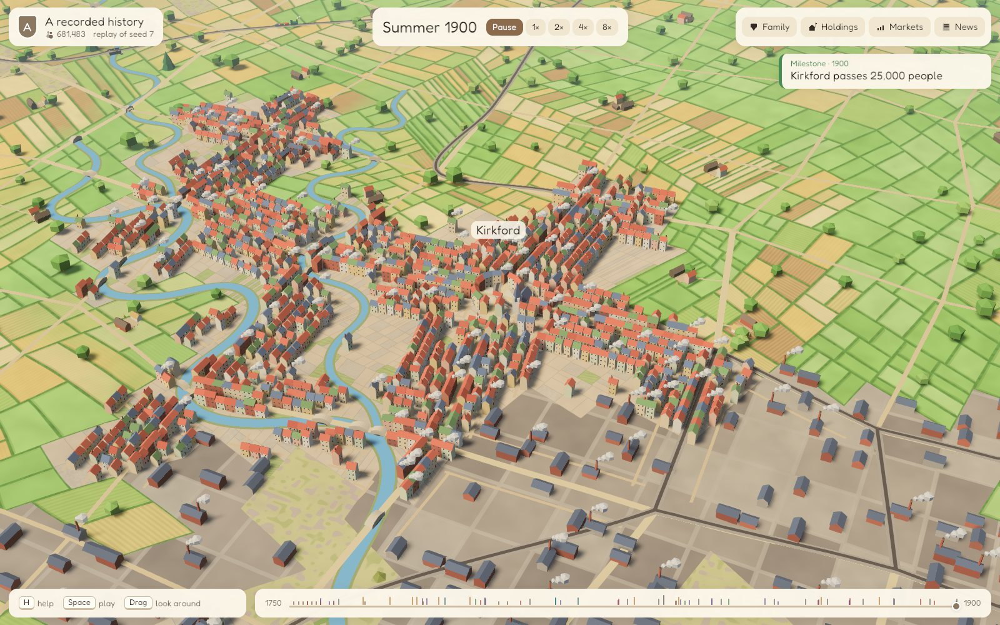

# isostate-viewer

A 3D replay viewer for Isolated State runs, in Bevy 0.20. It reads a `run.bin` written by the Python package (`python -m isostate run ...`) or by the Rust core, and draws the island as a small diorama you can scrub through from 1750 to 1900.



## Running

```bash
python -m isostate run --seed 7 --regime landlords --out runs/landlords     # or the Rust core's CLI
cargo run -p isostate-viewer --release -- runs/landlords/run.bin
```

The first build compiles Bevy and takes a while. On Linux you need `pkg-config`, `libwayland-dev` and `libxkbcommon-dev` to build; Windows and macOS need nothing extra.

| Key or mouse | Does |
|---|---|
| Space | play and pause (from 1750 if at the end) |
| Left / Right | step a year (Page Up / Page Down: ten) |
| Up / Down | faster or slower playback |
| Left drag, WASD | pan |
| Right drag, Q / E | turn and tilt |
| Wheel, R / F | zoom |
| T | tilt-shift (miniature focus) on and off |

Options: `--year 1846` opens on a year; `--size 1600x1000` sets the window.

### Screenshots without a window

Useful for checking the look on a machine with no GPU (it renders in software, so expect a few minutes):

```bash
WGPU_BACKEND=vulkan cargo run -p isostate-viewer -- runs/landlords/run.bin --size 1600x1000 \
    --view out/kirkford.png,1900,77.5,47.5,25,38,10 \
    --view out/island.png,1900
```

Each `--view` is `path,year,x,z,yaw,pitch,distance` in map cells and degrees; missing values fall back to the whole-island view. `--wait 100` sets how many seconds to wait for shaders to compile before the first shot.

## How the picture is made

The economy only knows shares and densities per 2 km cell, so the viewer invents the detail, deterministically.

- **Ground.** One heightfield mesh (four vertices per cell, relief exaggerated about three times) with a texture painted for each year. Each cell's two largest land classes are drawn as a patchwork using a smooth noise, so a cell that is 60% farm and 40% wood looks like fields with woods in them. Fields come from a warped grid with anti-aliased hedges; heath gets heather and gorse; steep ground turns to rock and high ground to snow. Everything about a texel that does not change (its cell, noise, field, depth, slope) is computed once, so repainting a year is cheap.
- **Things on the ground.** Every possible tree, house, farmstead and mine has a fixed slot with a fixed threshold, and it appears once its cell's share or density passes that threshold. Growth is therefore smooth and stable: nothing reshuffles from one year to the next, towns thicken in place and woods thin tree by tree.
- **Works.** Each firm in the replay has a stable plot in its cell, first come first served, and its building depends on its method (mills, furnaces, kilns, sheds) and grows in tiers as its capacity doubles. Chimneys of working firms smoke.
- **Towns.** A church on the market square, a station once the railway reaches the town, a lighthouse for harbours.
- **Lines.** Rivers, roads and railways are ribbons draped over the terrain through jittered cell centres; lines being built are dashed.
- **Light.** A low warm sun with shadows, soft sky light, screen-space ambient occlusion, distance haze, and an optional tilt-shift depth of field for the miniature look.

## What is next for the look

- Move field, hedge and crop drawing into a terrain shader so edges stay crisp at any zoom, with seasons from the monthly clock.
- Houses that line up along streets instead of a jittered grid.
- Moving trains and boats, construction that pops up with a puff of dust, and click-to-inspect with each works' "why here" sums.
