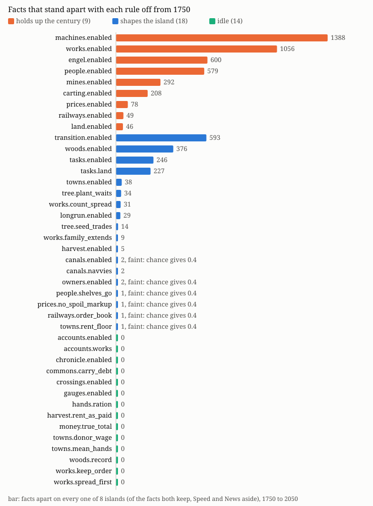

# The core of the island

Written by `isostate-core ablate`, played on 2026-11-19 (UTC) from the code at `a0bc253`, and read again from its files on 2026-11-19 with the code at `537145d` (`--again`, which plays nothing). Nothing on this page is written by hand: to make it again, run

```text
isostate-core ablate --out DIR --page docs/core.md
```

This one was made by `isostate-core ablate --out DIR --page docs/core.md --jobs 24`.

Every rule the game switches on is turned off from 1750, one at a time, and the island is played again: islands 1, 2, 3, 4, 5, 6, 7, 8 under the game's rules with 6 families, 1750 to 2050. Each such arm is set against the control, the islands as they are, island by island. 456 runs were played, 0 failed.

Of the 37 rules asked, 9 hold up the century, 19 shape the island, 9 are idle, 0 are leaned on.

Read the small counts with care. With 8 islands a side, a fact the rule does not move, only stirs (a rule that changes anything sends each island down another path), stands apart by chance once in 6,435 facts; a rule that stirs the island stirs some 2,700 facts, so 0.42 of them would stand apart by chance alone, and more than that where facts move together. A rule with no more facts apart than chance gives one time in twenty is marked *faint*, unless one of its facts is the same on every island of one arm, which chance cannot give.



## Every rule, by kind

| rule | kind | facts apart | by chance alone | differ, of those both keep | not kept | the twelve out of their band | time of a run |
|---|---|---:|---:|---:|---:|---|---:|
| `engel.enabled` | holds up the century | 503 | 0.40 | 2573 of 2681 | 239 | `pop_1900`, `urban_share_1900`, `income_share_land_1900` (not kept without it: `real_wage_chained_1850_vs_1750`, `real_wage_chained_1900_vs_1750`) | 106% |
| `machines.enabled` | holds up the century | 1081 | 0.44 | 2812 of 2914 | 6 | `real_wage_chained_1850_vs_1750`, `real_wage_chained_1900_vs_1750`, `urban_share_1900`, `rail_km_1900`, `income_share_work_1900` | 89% |
| `works.enabled` | holds up the century | 891 | 0.44 | 2819 of 2914 | 6 | `pop_1800`, `real_wage_chained_1850_vs_1750`, `real_wage_chained_1900_vs_1750`, `income_share_work_1900`, `income_share_land_1900` | 201% |
| `works.keep_order` | holds up the century | 1 | 0.44 | 2813 of 2919 | 1 | `rail_km_1900` | 108% |
| `railways.enabled` | holds up the century | 29 | 0.39 | 2515 of 2900 | 20 | `rail_km_1900` | 124% |
| `carting.enabled` | holds up the century | 294 | 0.42 | 2720 of 2825 | 95 | `pop_1800`, `pop_1850`, `urban_share_1900` | 111% |
| `people.enabled` | holds up the century | 286 | 0.43 | 2766 of 2870 | 50 | `pop_1800`, `pop_1850`, `towns_1900`, `urban_share_1900` | 90% |
| `mines.enabled` | holds up the century | 508 | 0.44 | 2814 of 2917 | 3 | `pop_1850`, `urban_share_1900`, `rail_km_1900` | 128% |
| `owners.enabled` | holds up the century | 10 | 0.42 | 2715 of 2823 | 97 | `pop_1900` | 139% |
| `prices.enabled` | shapes the island | 84 | 0.44 | 2815 of 2917 | 3 | none | 116% |
| `harvest.enabled` | shapes the island | 4 | 0.43 | 2795 of 2911 | 9 | none | 98% |
| `works.count_spread` | shapes the island | 14 | 0.44 | 2811 of 2919 | 1 | none | 117% |
| `works.family_extends` | shapes the island | 7 | 0.42 | 2716 of 2917 | 3 | none | 116% |
| `works.spread_first` | shapes the island (faint) | 1 | 0.44 | 2814 of 2917 | 3 | none | 112% |
| `railways.order_book` | shapes the island (faint) | 2 | 0.39 | 2532 of 2920 | 0 | none | 114% |
| `people.shelves_go` | shapes the island (faint) | 1 | 0.42 | 2726 of 2920 | 0 | none | 104% |
| `towns.enabled` | shapes the island | 38 | 0.44 | 2813 of 2917 | 3 | none | 104% |
| `towns.mean_hands` | shapes the island (faint) | 1 | 0.44 | 2809 of 2919 | 1 | none | 100% |
| `towns.donor_wage` | shapes the island (faint) | 1 | 0.42 | 2730 of 2917 | 3 | none | 106% |
| `towns.rent_floor` | shapes the island (faint) | 2 | 0.44 | 2813 of 2919 | 1 | none | 124% |
| `canals.navvies` | shapes the island | 1 | 0.42 | 2708 of 2917 | 3 | none | 106% |
| `tree.seed_trades` | shapes the island | 33 | 0.44 | 2812 of 2920 | 0 | none | 111% |
| `tree.plant_waits` | shapes the island | 27 | 0.44 | 2809 of 2920 | 0 | none | 114% |
| `hands.ration` | shapes the island | 1 | 0.44 | 2814 of 2919 | 1 | none | 143% |
| `longrun.enabled` | shapes the island | 133 | 0.42 | 2689 of 2880 | 40 | none | 143% |
| `transition.enabled` | shapes the island | 255 | 0.42 | 2683 of 2881 | 39 | none | 139% |
| `tasks.enabled` | shapes the island | 168 | 0.27 | 1724 of 2418 | 502 | none | 142% |
| `tasks.land` | shapes the island | 57 | 0.29 | 1869 of 2789 | 131 | none | 163% |
| `prices.no_spoil_markup` | idle | 0 | 0.44 | 2813 of 2919 | 1 | none | 97% |
| `harvest.rent_as_paid` | idle | 0 | 0.42 | 2713 of 2919 | 1 | none | 108% |
| `chronicle.enabled` | idle | 0 | 0.00 | 0 of 2920 | 0 | none | 108% |
| `canals.enabled` | idle | 0 | 0.41 | 2635 of 2836 | 84 | none | 92% |
| `accounts.enabled` | idle | 0 | 0.00 | 0 of 2235 | 685 | none (not kept without it: `income_share_work_1850`, `income_share_work_1900`, `income_share_land_1900`) | 151% |
| `accounts.works` | idle | 0 | 0.00 | 0 of 2920 | 0 | none | 167% |
| `gauges.enabled` | idle | 0 | 0.00 | 0 of 2595 | 325 | none | 166% |
| `commons.carry_debt` | idle | 0 | 0.00 | 0 of 2920 | 0 | none | 150% |
| `money.true_total` | idle | 0 | 0.44 | 2808 of 2919 | 1 | none | 136% |

The time of a run is the processor's time on a run with the rule off, against the control's (479 s on the clock for a run of the control): under a hundred per cent, the rule costs that much to run. It is taken on a machine shared with other work, whose load changed through the table, so only a time far from a hundred per cent says much.

## What each rule that holds up the century holds up

- **`engel.enabled`**: `pop_1900` (OUTSIDE), `urban_share_1900` (moved), `income_share_land_1900` (OUTSIDE).
  Largest apart: `farm_share_1900` 0.245 to 0.359 (9.6 spreads); `farm_share_1891_1910` 0.255 to 0.366 (8.0 spreads); `grain_output_1970_vs_1750` 25.50 to 57.96 (7.7 spreads); `grain_output_1920_vs_1750` 14.68 to 27.13 (6.8 spreads); `months_at_bound_lumber` 0.006 to 0.131 (6.7 spreads).
- **`machines.enabled`**: `real_wage_chained_1850_vs_1750` (OUTSIDE), `real_wage_chained_1900_vs_1750` (moved), `urban_share_1900` (moved), `rail_km_1900` (OUTSIDE), `income_share_work_1900` (OUTSIDE).
  Largest apart: `price_clay_in_wages_1900` 0.043 to 0.188 (24.6 spreads); `budget_food_1990` 0.124 to 0.273 (18.5 spreads); `price_clay_in_wages_1910` 0.044 to 0.188 (18.4 spreads); `price_clay_in_wages_1950` 0.046 to 0.212 (18.0 spreads); `price_clay_in_wages_2050` 0.057 to 0.250 (17.3 spreads).
- **`works.enabled`**: `pop_1800` (OUTSIDE), `real_wage_chained_1850_vs_1750` (moved), `real_wage_chained_1900_vs_1750` (moved), `income_share_work_1900` (OUTSIDE), `income_share_land_1900` (OUTSIDE).
  Largest apart: `cells_industry_1800` 17 to 394.2 (94.3 spreads); `works_1930` 1,512 to 11,501 (61.3 spreads); `cells_industry_1750` 3 to 262.2 (51.9 spreads); `works_hands_within_2_of_market_1850` 0.997 to 0.835 (40.6 spreads); `works_1940` 1,586 to 12,293 (37.0 spreads).
- **`works.keep_order`**: `rail_km_1900` (OUTSIDE).
  Largest apart: `carters_per_1000_weight_path_1800` 0.207 to 0.192 (0.3 spreads).
- **`railways.enabled`**: `rail_km_1900` (moved).
  Largest apart: `canal_traffic_end_vs_peak` 0.03 to 0.49 (8.6 spreads); `canal_mton_km_2050` 11.2 to 195 (7.1 spreads); `rail_km_1930` 2,646 to 1,140 (6.7 spreads); `rail_km_1950` 2,685 to 1,147 (6.7 spreads); `rail_km_1940` 2,669 to 1,142 (6.6 spreads).
- **`carting.enabled`**: `pop_1800` (OUTSIDE), `pop_1850` (OUTSIDE), `urban_share_1900` (moved).
  Largest apart: `mine_share_1751_1770` 0.150 to 0.056 (5.6 spreads); `mine_share_1931_1950` 0.216 to 0.136 (4.6 spreads); `mine_share_1750` 0.134 to 0.041 (4.4 spreads); `mine_share_first` 0.134 to 0.041 (4.4 spreads); `mine_share_1911_1930` 0.214 to 0.143 (3.6 spreads).
- **`people.enabled`**: `pop_1800` (moved), `pop_1850` (moved), `towns_1900` (OUTSIDE), `urban_share_1900` (OUTSIDE).
  Largest apart: `town_growth_near_old_cap` 0.245 to 0.984 (6.0 spreads); `town_growth_pct_p90` 1.37 to 1.10 (3.6 spreads); `area_mines_2050` 16.6 to 26.5 (2.9 spreads); `last_town_founded` 2009 to 1844 (2.7 spreads); `budget_comfort_1990` 0.216 to 0.192 (2.6 spreads).
- **`mines.enabled`**: `pop_1850` (OUTSIDE), `urban_share_1900` (OUTSIDE), `rail_km_1900` (OUTSIDE).
  Largest apart: `area_mines_1750` 0.292 to 751 (5758.6 spreads); `workings_share_of_cell_1750` 0.001 to 1.279 (4167.4 spreads); `area_mines_1800` 1.04 to 967 (2019.4 spreads); `area_mines_1850` 2.57 to 1,053 (1237.0 spreads); `area_mines_1920` 6.06 to 1,169 (901.8 spreads).
- **`owners.enabled`**: `pop_1900` (OUTSIDE).
  Largest apart: `income_pay_share_1750` 0.951 to 0.902 (2.0 spreads); `income_pay_share_1920` 0.901 to 0.803 (1.6 spreads); `hands_ironmine_1980` 0.002 to 0.003 (1.6 spreads); `real_income_1750` 1.52 to 1.62 (1.1 spreads); `income_pay_share_1930` 0.891 to 0.829 (1.0 spreads).

## The rules that shape the island

- **`prices.enabled`**, 84 apart: `farm_zigzag` 2.36 to 6.11 (8.0 spreads); `farm_zigzag_beyond_weather` 1.90 to 5.33 (7.5 spreads); `price_swing_cloth` 0.050 to 0.111 (6.8 spreads); `emigrants` 41.2 to 1,719 (5.8 spreads); `months_at_bound_lumber` 0.006 to 0.092 (4.6 spreads).
- **`harvest.enabled`**, 4 apart: `price_swing_grain` 0.105 to 0.046 (2.8 spreads); `output_swing_grain` 0.102 to 0.038 (2.0 spreads); `price_ac1_grain` -0.570 to -0.224 (1.7 spreads); `farm_zigzag` 2.36 to 1.68 (1.5 spreads).
- **`works.count_spread`**, 14 apart: `works_closing_chance_age_10_14` 0.027 to 0.045 (2.5 spreads); `works_closing_chance_age_6_9` 0.039 to 0.061 (1.9 spreads); `works_closing_chance_age_15_24` 0.021 to 0.028 (1.7 spreads); `cells_derelict_2020` 2.6 to 10.8 (1.6 spreads); `cells_industry_1970` 444.5 to 553.5 (1.0 spreads).
- **`works.family_extends`**, 7 apart: `works_1930` 1,512 to 1,883 (2.3 spreads); `works_closing_chance_age_15_24` 0.021 to 0.028 (1.7 spreads); `works_1940` 1,586 to 1,942 (1.2 spreads); `works_ex_services_1930` 1,487 to 1,858 (1.2 spreads); `works_ex_services_1940` 1,569 to 1,928 (1.1 spreads).
- **`works.spread_first`**, 1 apart: `hours_minders_1960` 1,347 to 1,633 (0.6 spreads).
- **`railways.order_book`**, 2 apart: `rail_spent_over_expected` 0.79 to 1.42 (4.0 spreads); `rail_cost_in_years_of_output` 0.223 to 0.324 (1.4 spreads).
- **`people.shelves_go`**, 1 apart: `books_goods_worst` 1.60e-10 to 6.74e-13 (0.4 spreads).
- **`towns.enabled`**, 38 apart: `urban_churn_10y` 0.003 to 0.083 (17.3 spreads); `cells_urban_2010` 575.1 to 171.2 (4.2 spreads); `cells_urban_1950` 439.8 to 156.9 (4.1 spreads); `cells_urban_2000` 551.8 to 175.5 (4.1 spreads); `cells_urban_1940` 408.2 to 148.4 (4.1 spreads).
- **`towns.mean_hands`**, 1 apart: `oil_to_machines_1940` 1.027 to 0.986 (0.4 spreads).
- **`towns.donor_wage`**, 1 apart: `hands_ironmine_1980` 0.002 to 0.003 (2.2 spreads).
- **`towns.rent_floor`**, 2 apart: `books_income_worst` 6.82e-15 to 1.14e-13 (12.5 spreads); `canal_works_near_1760` 0.613 to 0.789 (0.9 spreads).
- **`canals.navvies`**, 1 apart: `canal_most_navvies` 1,110 to 0 (1.1 spreads).
- **`tree.seed_trades`**, 33 apart: `hours_haul_1750` 4,821 to 3,615 (3.9 spreads); `hours_tend_1750` 7,204 to 5,736 (3.3 spreads); `hours_judge_1750` 4,149 to 3,487 (3.0 spreads); `budget_shelter_1750` 0.109 to 0.129 (2.7 spreads); `gauge_fork_made_1800` 1.70 to 2.14 (2.3 spreads).
- **`tree.plant_waits`**, 27 apart: `months_at_bound_lumber` 0.006 to 0.094 (4.7 spreads); `works_top_1pct_capacity_share_2050` 0.139 to 0.298 (3.2 spreads); `works_top_1pct_capacity_share_last` 0.139 to 0.298 (3.2 spreads); `hands_quarry_2050` 0.024 to 0.045 (2.9 spreads); `area_mines_2050` 16.6 to 24.5 (2.3 spreads).
- **`hands.ration`**, 1 apart: `town_months_more_at_work_than_people` 0 to 10.5 (1.3 spreads).
- **`longrun.enabled`**, 133 apart: `months_at_bound_oil` 0.000 to 0.417 (497.4 spreads); `months_at_bound_gas` 0.000 to 0.018 (26.3 spreads); `months_at_bound_lumber` 0.006 to 0.172 (8.9 spreads); `months_at_bound_electricity` 0.042 to 0.352 (4.3 spreads); `months_at_bound_machinery` 0.023 to 0.401 (3.5 spreads).
- **`transition.enabled`**, 255 apart: `area_mines_2050` 16.6 to 29.1 (3.7 spreads); `area_mines_2030` 13.1 to 22.6 (3.4 spreads); `months_at_bound_lumber` 0.006 to 0.066 (3.2 spreads); `hours_haul_2010` 31,957 to 40,010 (3.0 spreads); `area_mines_2020` 11.9 to 19.8 (3.0 spreads).
- **`tasks.enabled`**, 168 apart: `gauge_hand_hours_1960` 0.071 to 0.088 (3.3 spreads); `real_wage_2000_vs_1750` 0.60 to 1.44 (3.1 spreads); `gauge_hand_hours_1940` 0.080 to 0.099 (3.0 spreads); `electricity_lost_2010` 0.029 to 0.100 (2.2 spreads); `gauge_hand_hours_1970` 0.068 to 0.086 (2.2 spreads).
- **`tasks.land`**, 57 apart: `oil_to_machines_2020` 1.008 to 0.000 (27.3 spreads); `oil_to_machines_2050` 0.999 to 0.000 (25.0 spreads); `oil_to_machines_2010` 1.007 to 0.000 (21.5 spreads); `oil_to_machines_2030` 1.012 to 0.000 (13.5 spreads); `oil_to_machines_2040` 1.018 to 0.000 (10.3 spreads).

## The idle rules, and the second pass

- **`prices.no_spoil_markup`**: it stirs the island (2813 of the 2919 facts both keep differ) and moves no fact clear of the spread.
- **`harvest.rent_as_paid`**: it stirs the island (2713 of the 2919 facts both keep differ) and moves no fact clear of the spread.
- **`chronicle.enabled`**: no fact differs on any island.
- **`canals.enabled`**: it stirs the island (2635 of the 2836 facts both keep differ) and moves no fact clear of the spread.
- **`accounts.enabled`**: no fact both keep differs on any island, and it keeps 685 facts the island does not keep without it: it watches.
- **`accounts.works`**: no fact differs on any island.
- **`gauges.enabled`**: no fact both keep differs on any island, and it keeps 325 facts the island does not keep without it: it watches.
- **`commons.carry_debt`**: no fact differs on any island.
- **`money.true_total`**: it stirs the island (2808 of the 2919 facts both keep differ) and moves no fact clear of the spread.

**The second pass**: the 8 idle rules turned off together are not the same island. With all of them off: the century does not stand (`rail_km_1900` OUTSIDE); 8 apart, the largest `wage_scale_1960` 2.72 to 3.77 (2.0 spreads); `wage_scale_1920` 2.10 to 2.78 (1.7 spreads); `wage_scale_1950` 2.60 to 3.41 (1.7 spreads); `wage_scale_1980` 3.24 to 4.40 (1.5 spreads); `wage_scale_2000` 3.50 to 4.71 (1.4 spreads). The smallest groups that must not go off together, each idle alone:

- `prices.no_spoil_markup` with `harvest.rent_as_paid`: with both off, 2 apart, the largest `wage_scale_1900` 1.83 to 2.30 (1.8 spreads); `carters_per_1000_weight_path_1960_vs_1750` 0.62 to 0.39 (0.3 spreads).
- `prices.no_spoil_markup` with `canals.enabled`: with both off, the century does not stand (`rail_km_1900` OUTSIDE); 3 apart, the largest `carters_share_of_hands_1900` 0.084 to 0.072 (0.8 spreads); `carting_share_of_output_1900` 0.056 to 0.047 (0.8 spreads); `carting_share_of_output_1950` 0.056 to 0.046 (0.6 spreads).
- `prices.no_spoil_markup` with `money.true_total`: with both off, 6 apart, the largest `wage_scale_1960` 2.72 to 3.76 (2.0 spreads); `wage_scale_1900` 1.83 to 2.32 (1.8 spreads); `wage_scale_1950` 2.60 to 3.41 (1.7 spreads); `wage_scale_1990` 3.45 to 4.70 (1.7 spreads); `wage_scale_2000` 3.50 to 4.97 (1.7 spreads).

With `harvest.rent_as_paid` and `canals.enabled` and `money.true_total` kept on, the other 5 go off together and the island is the same: `prices.no_spoil_markup`, `chronicle.enabled`, `accounts.works`, `gauges.enabled`, `commons.carry_debt`.

`accounts.enabled` is idle as this page reads the table, and was not among the rules the second pass turned off together, since the pass was played with the reading of its day; the next table puts it there.

The arms the second pass played, in order:

- 8 rules off: not the same island
  (prices.no_spoil_markup, harvest.rent_as_paid, chronicle.enabled, canals.enabled, accounts.works, gauges.enabled, commons.carry_debt, money.true_total)
- 4 rules off: not the same island
  (prices.no_spoil_markup, harvest.rent_as_paid, chronicle.enabled, canals.enabled)
- 4 rules off: the same island
  (accounts.works, gauges.enabled, commons.carry_debt, money.true_total)
- 2 rules off: not the same island
  (prices.no_spoil_markup, harvest.rent_as_paid)
- 2 rules off: the same island
  (chronicle.enabled, canals.enabled)
- 7 rules off: not the same island
  (prices.no_spoil_markup, chronicle.enabled, canals.enabled, accounts.works, gauges.enabled, commons.carry_debt, money.true_total)
- 3 rules off: not the same island
  (prices.no_spoil_markup, chronicle.enabled, canals.enabled)
- 2 rules off: the same island
  (prices.no_spoil_markup, chronicle.enabled)
- 2 rules off: not the same island
  (prices.no_spoil_markup, canals.enabled)
- 6 rules off: not the same island
  (prices.no_spoil_markup, chronicle.enabled, accounts.works, gauges.enabled, commons.carry_debt, money.true_total)
- 3 rules off: the same island
  (prices.no_spoil_markup, chronicle.enabled, accounts.works)
- 3 rules off: the same island
  (gauges.enabled, commons.carry_debt, money.true_total)
- 4 rules off: not the same island
  (prices.no_spoil_markup, gauges.enabled, commons.carry_debt, money.true_total)
- 5 rules off: the same island
  (chronicle.enabled, accounts.works, gauges.enabled, commons.carry_debt, money.true_total)
- 2 rules off: the same island
  (prices.no_spoil_markup, gauges.enabled)
- 3 rules off: not the same island
  (prices.no_spoil_markup, commons.carry_debt, money.true_total)
- 2 rules off: the same island
  (prices.no_spoil_markup, commons.carry_debt)
- 2 rules off: not the same island
  (prices.no_spoil_markup, money.true_total)
- 5 rules off: the same island
  (prices.no_spoil_markup, chronicle.enabled, accounts.works, gauges.enabled, commons.carry_debt)

## The century after 1900

What the design asks of the years after 1900, as the standing check reports it (`docs/rules/README.md`, "The standing check"); reported, not counted in the kinds. Only the arms that differ from the control are listed.

| | per cent a year, 1900 to 1970 | 2050 over 1970 | 2050 less 1900 |
|---|---:|---:|---:|
| the control | -0.00% (missed) | 0.50 (missed) | +0.111 (missed) |
| `prices.enabled` off | 0.04% (missed) | 0.66 (missed) | +0.119 (missed) |
| `prices.no_spoil_markup` off | 0.38% (missed) | 0.41 (missed) | +0.101 (missed) |
| `engel.enabled` off | - (-) | - (-) | +0.082 (missed) |
| `machines.enabled` off | 0.10% (missed) | 0.46 (missed) | +0.221 (missed) |
| `harvest.enabled` off | 0.04% (missed) | 0.55 (missed) | +0.104 (missed) |
| `harvest.rent_as_paid` off | 0.12% (missed) | 0.54 (missed) | +0.117 (missed) |
| `works.enabled` off | 0.25% (missed) | 0.51 (missed) | +0.195 (missed) |
| `works.count_spread` off | -0.02% (missed) | 0.58 (missed) | +0.103 (missed) |
| `works.family_extends` off | -0.13% (missed) | 0.60 (missed) | +0.106 (missed) |
| `works.spread_first` off | 0.16% (missed) | 0.51 (missed) | +0.109 (missed) |
| `works.keep_order` off | 0.46% (missed) | 0.49 (missed) | +0.117 (missed) |
| `railways.enabled` off | 0.17% (missed) | 0.55 (missed) | +0.116 (missed) |
| `railways.order_book` off | 0.02% (missed) | 0.60 (missed) | +0.105 (missed) |
| `carting.enabled` off | 0.37% (missed) | 0.55 (missed) | +0.088 (missed) |
| `people.enabled` off | -0.30% (missed) | 0.56 (missed) | +0.130 (missed) |
| `people.shelves_go` off | 0.21% (missed) | 0.58 (missed) | +0.110 (missed) |
| `towns.enabled` off | 0.26% (missed) | 0.52 (missed) | +0.094 (missed) |
| `towns.mean_hands` off | 0.31% (missed) | 0.46 (missed) | +0.111 (missed) |
| `towns.donor_wage` off | 0.10% (missed) | 0.53 (missed) | +0.112 (missed) |
| `towns.rent_floor` off | 0.15% (missed) | 0.52 (missed) | +0.108 (missed) |
| `mines.enabled` off | 0.25% (missed) | 0.52 (missed) | +0.147 (missed) |
| `canals.enabled` off | 0.03% (missed) | 0.63 (missed) | +0.118 (missed) |
| `canals.navvies` off | 0.17% (missed) | 0.54 (missed) | +0.107 (missed) |
| `tree.seed_trades` off | 0.28% (missed) | 0.47 (missed) | +0.117 (missed) |
| `tree.plant_waits` off | 0.26% (missed) | 0.52 (missed) | +0.040 (missed) |
| `hands.ration` off | 0.10% (missed) | 0.55 (missed) | +0.115 (missed) |
| `money.true_total` off | 0.16% (missed) | 0.51 (missed) | +0.113 (missed) |
| `longrun.enabled` off | 0.06% (missed) | 0.49 (missed) | +0.136 (missed) |
| `transition.enabled` off | 0.26% (missed) | 0.40 (missed) | +0.139 (missed) |
| `owners.enabled` off | 0.42% (missed) | 0.52 (missed) | +0.106 (missed) |
| `tasks.enabled` off | 0.37% (missed) | 0.61 (missed) | +0.102 (missed) |
| `tasks.land` off | 0.35% (missed) | 0.51 (missed) | +0.145 (missed) |

## What was left out, and why

- `F_max`: 60000 under the game's rules and 20000 under the port's; fixed when the island is made, and not a switch: its off is not one value.
- `land.enabled`: off under the game's rules already: there is nothing to turn off.
- `tree.stage`: 6 under the game's rules and 0 under the port's; fixed when the island is made, and not a switch: its off is not one value.
- `tree.canal_stone`: 0.35 under the game's rules and 1.0 under the port's: a number or a choice, not a switch, so its off is not one value.
- `roads.enabled`: off under the game's rules already: there is nothing to turn off.
- `woods.enabled`, `woods.record`, `crossings.enabled`: switched on under the game's rules since this table was played, so not in it; the next table asks them.

## How to read it

The rules asked are found in the tree's own lists, not in one kept for this page: every true-or-false name the rulebook's walk (`rulebook.rs`) finds on under the game's rules and off under the port's, and every lesser switch of a rule the game switches on. A rule added tomorrow is asked too. An arm turns one of them off from 1750 with everything else as it is, exactly what `sweep --set NAME=false` plays.

A fact **stands apart** when every island of the arm lies above, or below, every island of the control, as `sweep --compare` stars a fact (4 islands or more a side). Only the facts both arms keep are counted, and not those of Speed or News: how long a run took is no fact about the island, and the news is what the chronicle writes about it. A fact's **size** is the change of the means over the control's spread from island to island; "from nothing" is a fact that is the same on every island of the control.

The kinds, by those numbers alone: **leaned on**, a run fails with the rule off (other rules lean on it); **holds up the century**, one of the standing check's twelve facts of 1750 to 1900 is not inside the control's band (moved, OUTSIDE, or without a value); **shapes the island**, facts stand apart and the twelve stay inside; **idle**, nothing stands apart. An idle rule that keeps facts the island does not keep without it watches the island (the books, the gauges) and is idle by design.

Rules cover for each other: two that mend one behaviour each look idle alone. So **the second pass** turns every idle rule off together. If that arm is idle too, the island is the same island with fewer rules. If not, the set is halved until the smallest groups that must not go off together are found; one of each group is kept on, and the rest are tried again.

Nothing here switches a rule off under the game's rules. What is switched off is decided after the table is read, and the rule's page then says since when and why.
