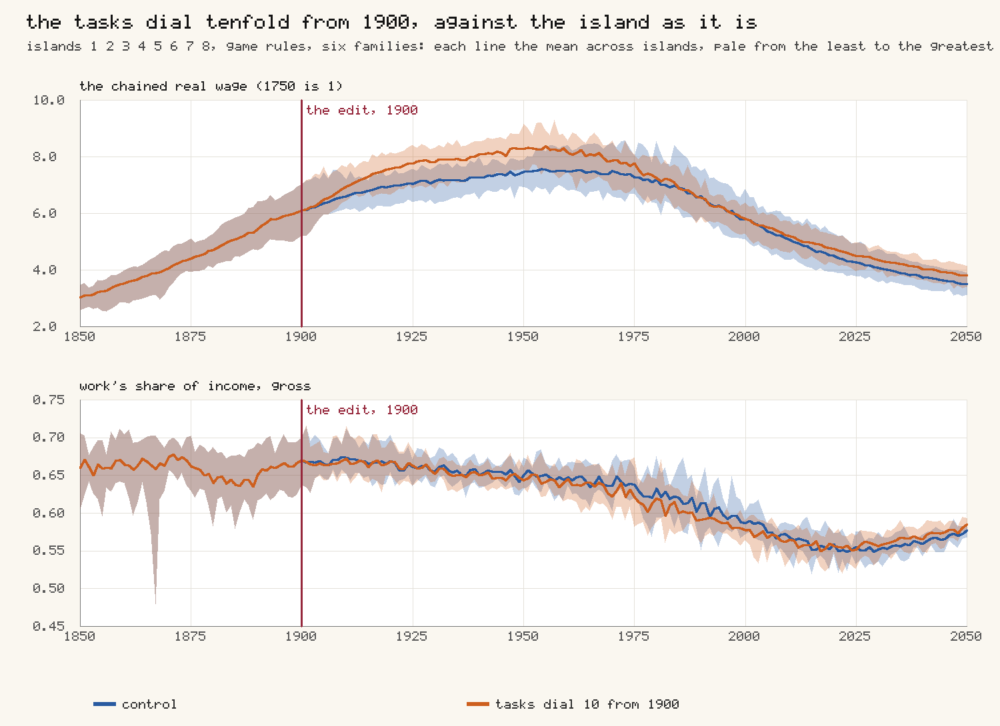

# The lab

The island as a laboratory: one command plays the same islands twice from
1750, once as they are and once with a list of edits by hand, and says what
changed, island by island. It is a tool, not a rule. It changes nothing a run
does, so it has no switch and no page under `docs/rules/`. The code is
`crates/isostate-core/src/lab.rs`, whose opening comment is its manual, and
`tests/lab.rs` holds it to what is said here.

## Asking the island a question

A question about the island is a question about two islands: the one that
was, and the one where something was done differently from some year on.
"What does turning the machines' dial tenfold in 1900 do to wages and to
work's share by 1950 and by 2050, across eight islands?" is answered by
playing islands 1 to 8 as they are (the **control**) and again with the dial
set to ten before January 1900 (the **treated arm**), and setting each island
against itself:

```text
isostate-core lab --out L1 --rule tasks.dial=10@1900
```

Both arms of an island draw the same random numbers until the edit, so up to
1900 they are the same island to the last digit, and what differs after is
the edit's doing on that island. The lab says in which year the two arms
first part (on each island, the first year whose yearly means differ in any
of the observer's series), then gives a row for each fact and year: the
control's mean across the islands, the treated arm's, the change of the
means, the least and the greatest change on any one island, and on how many
islands the fact is higher and lower. Where the change is small against the
spread from island to island, or the islands split four and four, the edit
has not been shown to do anything.

Every run begins in 1750. An experiment of eight islands to 2050 is sixteen
runs, about what two sweeps cost. Grids of many settings, or many edits from
1950, will want the island saved part way and played on from there
(snapshots), which does not exist yet.

## The command and its defaults

```text
isostate-core lab --out DIR [--rule NAME=V1[,V2...]@YEAR]... [--edits FILE.json]
                  [--seeds 1-8] [--rules port|game] [--families N] [--end-year Y]
                  [--years 1850,1900,1950,2000,2050] [--facts NAME,...] [--jobs N] [--quiet]
```

- `--rule NAME=V@YEAR` sets one of the rules' numbers or switches, by the
  dotted name `sweep --set` takes, before January of YEAR: the same edit the
  Rules tab makes in a running island. It may be given more than once, and
  all go into the treated arm. One of them may carry several values
  (`--rule tasks.dial=3,10,100@1950`), and then there is a treated arm for
  each value, all set against the one control. A rule with no year is
  refused: a rule set from the very start is a setting of its own, for
  `sweep --set`.
- `--edits FILE.json` reads a list of dated edits (below), the file
  `run --edits` reads, and puts it in the treated arm before any `--rule`.
- `--seeds` (islands 1 to 8), `--rules` (the game's), `--families` (6) and
  `--end-year` (2050) say which islands are played, and how.
- `--years` (1850, 1900, 1950, 2000 and 2050, those of them inside the run)
  are the years the facts are read in. The facts are taken in 1750, every
  fiftieth year to 1900, every tenth after it and the last; a year between
  shows `-` for a fact, and the table's head says so.
- `--facts` replaces the rows below with a list of its own: names with `{Y}`
  in them (`gauge_floor_{Y}`), plain names (`hoist_found_year`), and
  `series:NAME` for the year's mean of any observer series
  (`series:acct_share_work`).
- `--jobs` is how many runs at a time (half the machine's cores);
  `--quiet` leaves out the line printed as each run finishes.

Whatever can be refused is refused before the first run and before anything
is written: a date outside the run, a month that is not 1 to 12, two `--rule`s
with several values each, and every rule edit, checked in the order of its
date against the rules as the earlier edits leave them, in the sentence the
running island would give (a rule that sizes the island, a switch not shown
to be safe to throw, a value that is already the rule's). An idea found or a
town founded by hand can only be refused in the running island: that run is
reported as failed with the edit's sentence, and the others carry on.

## The rows

`{Y}` is each of the years.

Wages
- `real_wage_chained_{Y}_vs_1750`: the real wage, chained year to year so
  that new goods in the basket do not jump it, against 1750's.
- `real_income_{Y}`: the households' budget over what bare subsistence
  costs (`docs/rules/engel.md`), 1 being just enough to eat.

Work's share and the rest of income
- `income_share_work_{Y}`: work's share of the island's income in the books,
  before the plant worn out is paid for (gross).
- `gauge_work_net_{Y}`: the same once the wear on the works is taken off what
  their owners keep (net of wear; `docs/rules/gauges.md`).
- `income_share_works_{Y}` and `income_share_land_{Y}`: what the works'
  owners and the land's take.

Who owns the works (`docs/rules/owners.md`)
- `owners_works_families_{Y}`, `owners_works_lords_{Y}` and
  `owners_works_hh_{Y}`: the shares of the works' book held by the
  families, by the landlords, and by the households. They have no value
  under rules with the owners' stage off.

Which tasks machines take (`docs/rules/tasks.md`)
- `auto_haul_works_{Y}` and `auto_haul_pits_{Y}`: the share of the hauling in
  the works, and in the quarries, clay pits and mines, done by machine.
- `machines_years_{Y}`: the machines' book over the year's wage bill.
- `gauge_plant_years_{Y}`: the works' plant in years of the island's income.

People and places
- `pop_{Y}`, `farm_share_{Y}` (the share of hands on the land) and
  `urban_share_{Y}` (the share of people in towns).

Money
- `series:money {Y}`: the year's mean of the money on the island.

## The files

`DIR/lab.txt` is the table as printed. `DIR/lab.csv` is the same in long form,
one line for each treated arm, island, row and year, with the control's
value, the arm's and the change, in full. `DIR/edits.json` lists every arm
with its edits, and `README.txt` the command, the code it ran on and each
arm's list. Each arm also has a directory of its own, `control/`, `arm-1/` and
so on, holding `facts.json`, `facts.csv` and `annual.csv` in the sweep's own
form, and its list of edits as `edits.json`. So `sweep --compare DIR/control`
and `isostate-core scorecard DIR/arm-1` read an arm as they read a sweep, a
chart can be drawn from each arm's `annual.csv`, and an arm can be played
again alone with `run --edits DIR/arm-1/edits.json`.

There is no chart in the command: the repository draws only inside the
viewer, and no library is added to draw outside it. A short script reading the
arms' `annual.csv` draws one (below).

## Writing a list of edits

A list of edits is JSON: each edit with the month it is carried out before,
as `[year, month]`, months 1 to 12, so `[1800, 1]` is at the turn of 1799 into
1800. One of each kind, as `tests/edits.rs` writes them:

```json
[
  {"before": [1800, 1], "edit": {"what": "rule", "name": "money.growth", "value": 0}},
  {"before": [1820, 1], "edit": {"what": "money", "purse": "households", "factor": 2.0}},
  {"before": [1820, 3], "edit": {"what": "people", "town": 4, "factor": 0.5}},
  {"before": [1830, 6], "edit": {"what": "harvest", "factor": 0.7}},
  {"before": [1840, 1], "edit": {"what": "discover", "tech": "coke_furnace", "town": 2}},
  {"before": [1850, 1], "edit": {"what": "found_town", "cell": 5000}}
]
```

`money` multiplies a purse (`households`, `landlords` or `merchants`), in one
`town` or, with none named, in every town, by 0.1 to 10; `people` a town's
people by 0.1 to 10; `harvest` the rest of the year's crop, round one `town`
or on the whole island, by 0.2 to 2. `discover` finds an idea, by its name in
the content, in a town; `found_town` orders a town on a square (numbered row
by row from the island's north-west corner), founded at the year's end;
`rule` sets a rule by name. A town numbered here is the same town in both
arms only up to the edit, so a town or a square is best named for an edit
early in the run, or for one island at a time.

## Three experiments

Played on 19 November 2026 with the code of this page's first commit, eight
islands to 2050 under the game's rules with six families, sixteen runs at a
time. The machine was busy with other builds, so each took four to five
minutes where a quiet machine would take about three (one sweep of eight
islands to 2050 took 88 s on a quiet machine). Read every number after 1950
knowing that the island as it stands grows poorer after 1950: its chained
wage halves from there to 2050 and its hands go back to the fields, with the
land's machines not yet built. A change in 2050 is a change on that island.

Each table below is a dozen rows of the lab's own, copied from `lab.txt`.

### The tasks dial tenfold from 1900

```text
isostate-core lab --out L1 --rule tasks.dial=10@1900          (301 s, 16 at a time)
```

The dial multiplies the quality of the machines that take tasks, and in this
code the one such machine is the hoist. The arms do not part in 1900, since a
dial on a machine nobody has found multiplies nothing: they part in the year
each island finds the hoist, 1901 on five islands, 1903 on one and 1907 on two,
exactly the year of `hoist_found_year` on each.

```text
where the arms part: the first year whose yearly means differ in any observer series, island by island
  tasks.dial=10 from 1900: the arms part in 1901 on 5 islands (1, 2, 5, 6, 8); in 1903 on 1 island (7); in 1907 on 2 islands (3, 4)

                                      control  tasks.dial=10 from 1900           change                        up/down
  real_wage_chained_1950_vs_1750         7.37                     8.17            +0.80  [+0.56 .. +1.24]          8/0
  real_wage_chained_2000_vs_1750         5.72                     5.73            +0.01  [-0.49 .. +0.20]          4/4
  real_wage_chained_2050_vs_1750         3.45                     3.76            +0.31  [+0.19 .. +0.38]          8/0
  income_share_work_1950                0.650                    0.643           -0.007  [-0.030 .. +0.013]        3/5
  income_share_work_2050                0.577                    0.585           +0.008  [-0.004 .. +0.019]        7/1
  gauge_work_net_2000                   0.639                    0.623           -0.016  [-0.027 .. -0.003]        0/8
  gauge_work_net_2050                   0.601                    0.608           +0.008  [+0.001 .. +0.017]        8/0
  owners_works_families_2050            0.308                    0.271           -0.037  [-0.061 .. -0.021]        0/8
  owners_works_lords_2050               0.419                    0.439           +0.020  [+0.008 .. +0.038]        8/0
  auto_haul_works_1950                  0.441                    0.867           +0.426  [+0.421 .. +0.428]        8/0
  auto_haul_works_2050                  0.537                    0.950           +0.412  [+0.407 .. +0.421]        8/0
  real_income_2000                       6.78                     6.36            -0.42  [-0.64 .. -0.29]          0/8
```

By 1950 machines do 0.87 of the works' hauling against 0.44, on every island
by almost the same amount, and the chained wage stands 0.80 higher (7.37 to
8.17), higher on all eight islands. Work's share gross moves by under a
hundredth, three islands up and five down, well inside the spread. By 2050, on
an island grown poorer, the wage is still 0.31 higher on all eight, work's
share net is less than a hundredth higher on all eight, and the families hold
less of the works (0.31 to 0.27) and the landlords more. In 2000 the wage is
the same and the households' real income 0.42 lower on all eight.



### The owners' stage switched off from 1900

```text
isostate-core lab --out L2 --rule owners.enabled=false@1900   (259 s, 16 at a time)
```

The arms part in 1900 on all eight islands. With the stage off, the owners'
rule keeps no yearly record, so the rows of who owns the works have no value
in the treated arm after 1900.

```text
  owners.enabled=false from 1900: the arms part in 1900 on 8 of 8 islands

                                      control  owners.enabled=false from 1900           change                         up/down
  real_wage_chained_1950_vs_1750         7.37                            7.29            -0.09  [-0.39 .. +0.30]           2/6
  real_wage_chained_2050_vs_1750         3.45                            3.50            +0.05  [-0.14 .. +0.17]           6/2
  real_income_1900                      10.24                           10.72            +0.48  [+0.28 .. +0.73]           8/0
  real_income_1950                       9.27                            9.75            +0.48  [+0.31 .. +0.68]           8/0
  real_income_2050                       3.07                            3.45            +0.37  [+0.29 .. +0.52]           8/0
  income_share_work_1950                0.650                           0.649           -0.001  [-0.029 .. +0.025]         3/5
  income_share_work_2050                0.577                           0.572           -0.005  [-0.013 .. +0.004]         2/6
  gauge_work_net_1950                   0.674                           0.673           -0.002  [-0.019 .. +0.020]         2/6
  gauge_work_net_2050                   0.601                           0.597           -0.004  [-0.012 .. +0.005]         2/6
  owners_works_families_1950            0.493                               -
  auto_haul_works_1950                  0.441                           0.447           +0.006  [+0.002 .. +0.012]         8/0
  pop_2050                          2,787,989                       2,721,401  -66,588 (-2.4%)  [-104,351 .. -29,111]      0/8
```

The households' real income is about half a subsistence higher from the first
year on, on all eight islands, through 1950 and to 2050. The chained wage and
work's share, gross and net, move by less than the islands differ, and in no
steady direction. Machines haul a little more by 1950 on all eight (0.006),
and by 2050 there are 2.4 per cent fewer people, fewer on all eight.

### Money's growth set to none in 1800

```text
isostate-core lab --out L3 --edits L3-edits.json               (277 s, 16 at a time)
```

with `L3-edits.json` holding
`[{"before": [1800, 1], "edit": {"what": "rule", "name": "money.growth", "value": 0}}]`.
The arms part in 1800 on all eight islands.

```text
  L3-edits.json: the arms part in 1800 on 8 of 8 islands

                                      control  L3-edits.json                 change                                  up/down
  real_wage_chained_1850_vs_1750         3.00           2.58                  -0.42  [-0.78 .. -0.09]                    0/8
  real_wage_chained_1900_vs_1750         6.03           4.92                  -1.11  [-1.85 .. -0.49]                    0/8
  real_wage_chained_1950_vs_1750         7.37           5.81                  -1.56  [-2.14 .. -1.16]                    0/8
  real_wage_chained_2050_vs_1750         3.45           2.46                  -0.99  [-1.33 .. -0.74]                    0/8
  real_income_1900                      10.24           8.15                  -2.09  [-2.67 .. -1.70]                    0/8
  income_share_work_1950                0.650          0.666                 +0.015  [-0.011 .. +0.043]                  6/2
  income_share_work_2050                0.577          0.596                 +0.019  [+0.014 .. +0.030]                  8/0
  owners_works_families_1950            0.493          0.371                 -0.122  [-0.198 .. -0.079]                  0/8
  auto_haul_works_1950                  0.441          0.364                 -0.077  [-0.127 .. -0.032]                  0/8
  pop_1950                          1,055,126      1,240,225      +185,099 (+17.5%)  [+137,291 .. +220,937]              8/0
  urban_share_1950                      0.442          0.383                 -0.060  [-0.068 .. -0.053]                  0/8
  series:money 1900                42,221,945      7,277,082   -34,944,862 (-82.8%)  [-34,944,862 .. -34,944,862]        0/8
```

The money holds at 7.28 million on every island from 1800, where it would
have reached 17.6 million by 1850 and 42.2 million by 1900. Read from the arms'
`annual.csv`, prices (`cpi`) stand at 0.34 in 1850 against 0.72 (1750 is
0.97), and real output (`gdp_real`) is 12.5 per cent lower by 1900, both on
all eight islands. The chained wage is lower on all eight from 1850, by 1.56
in 1950 and by 0.99 in 2050. Work's share gross is a little higher (0.015 by
1950, inside the spread; 0.019 by 2050, on all eight), the families hold an
eighth less of the works and the landlords and households more, machines haul
less, and there are a sixth more people by 1950, fewer of them in towns.

## The picture

The picture above was drawn from the two arms' `annual.csv` by a short
script of about a hundred lines, using nothing but Python's standard library:
for each panel, each year's mean across the islands for each arm, a pale band
from the least island to the greatest, and a line at the edit. Any column of
`annual.csv` can be drawn the same way.
