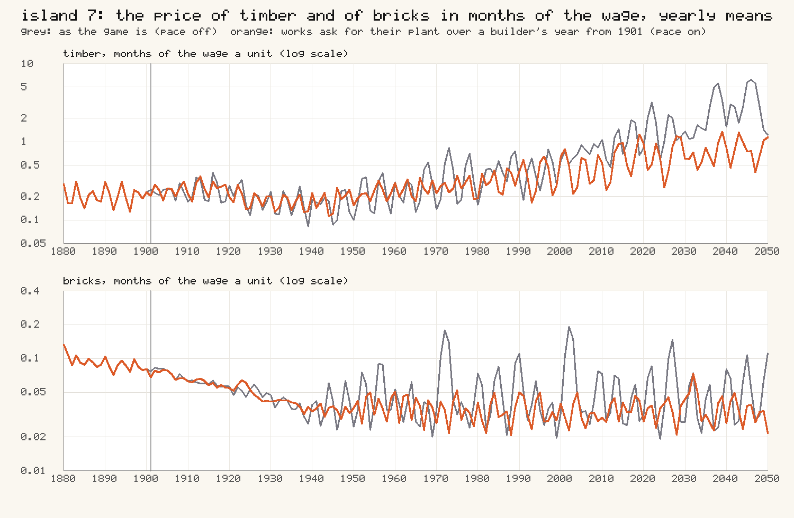

# tr-timber: the timber-and-brick cycle, traced

Branch `night/g-timber-trace`, from `main` at e7763a5 (25 November 2026). The question: why the price of timber swings fivefold every four or five years after 1900, and bricks' too after 1960; whether that is a fault of the merchants' stock, of how the woods are cut or of how building is ordered; and the smallest honest cure. Everything is under the game's rules with six families, on islands 1 to 16 to 2050 for the description and the cure, and 1 to 8 for the arms. The measuring program is `crates/isostate-core/examples/timber_trace.rs`: one island a month at a time, with each month's price, anchor, expected price, made, asked, sold and stock of timber, sawn timber, bricks and building work, the plant on order in each, the woods' hands and the cover of the woods being worked, and each year who took each good (the books) and which trades ordered it for plant.

## In short

**The cycle is the works' orders for plant, landing on markets nobody else is in any more.** The loop in five lines:

1. Timber is cheap after a glut; the year's review finds the cloth mills over the hurdle, and in a town they take their whole year's room together (`firms::review`, at least a fifth of a works' capacity).
2. A mill is plant of 10 timber a unit, and from the 1950s the mills order 91 per cent of the timber that goes into plant; one year's orders reach 260 thousand units on island 7, more than the woods cut in a year, and each order asks for a quarter of what is still to come every month (`econ::step_month`, the orders for capacity), so most of it in a season.
3. The households have left timber (5 thousand units a year of 150 to 300 thousand) and bricks (none after 1950), so nobody gives way: the shelves empty, the merchants mark the price up, and the woodmen, who hire on a price they expect a few months late and move a seventh of the way each month (`expect_rate`, `labor_adjust_ex`), come in when the orders are already filled and cut the few woods by the towns bare.
4. The year's orders filled, the cut runs on into a glut of ten or twenty months of sales; the price comes down at most 12 per cent a month and timber is cheap again three or four years after it was cheap before.
5. Bricks ride the same orders: every trade's plant is bricks, and after 1950 the works being built take all of them.

**The arm that proves it**: plant built without timber, sawn timber or bricks from 1900 (a counterfactual, not a cure) takes timber's swing from 0.51 to 0.11 and bricks' from 0.49 to 0.11, lower on eight islands of eight; a smaller year's room (0.15 to 0.05) takes timber's to 0.21. No arm on the merchants or on the woods brings either under 0.87 of what it was.

**The cure on trial**: `pace` (docs/rules/pace.md), off under both sets of rules. From 1901 a works asks for its plant over a builder's year, a twelfth of what is to come each month and not a quarter. On islands 1 to 16 it takes timber's swing from 0.53 to 0.40 and bricks' from 0.49 to 0.28, lower on all sixteen; the twelve standing facts stand to the last digit, the three growth asks are met and met better, and the wage after 1970 is higher. It does not end timber's cycle: the rest is the woodmen's slow answer, which the arms show and which this piece leaves (below).

## 1. What it is

Islands 1 to 16, the game's rules, six families, to 2050 (`isostate-core sweep --seeds 1-16 --rules game --families 6 --end-year 2050`). The swing is the standard deviation of the yearly change in the log of a price over the wage (the sweep's `price_swing_*`, against the wage); "five-year" is the mean, over every five-year window, of the dearest year over the cheapest, with the worst window in brackets; the period is the strongest between two and twelve years of the log about its centred nine-year mean.

| | 1850-99 | 1900-49 | 1950-99 | 2000-50 |
|---|---|---|---|---|
| timber's swing [least .. greatest island] | 0.28 [0.17 .. 0.34] | 0.45 [0.33 .. 0.53] | 0.55 [0.39 .. 0.68] | 0.57 [0.41 .. 0.70] |
| timber, five-year dearest over cheapest | 1.5 (2.7) | 2.3 (5.4) | 3.2 (21) | 3.7 (16) |
| timber's period, years | 3.3 | 3.8 | 4.8 | 5.2 |
| timber, months of the wage a unit | 0.26 | 0.21 | 0.41 | 1.03 |
| bricks' swing | 0.39 | 0.21 | 0.55 | 0.58 |
| bricks, five-year dearest over cheapest | 2.0 (4.8) | 1.4 (3.7) | 3.3 (9.3) | 3.5 (13) |
| sawn timber's swing | 0.19 | 0.38 | 0.64 | 0.68 |
| building work's swing | 0.04 | 0.06 | 0.12 | 0.12 |

- **When it begins.** Timber's swing passes 0.3 in a decade between the 1860s and the 1890s on every island, and keeps growing to 2050. Bricks swung before 1900 too (the households and the contract builders bought half of them), were quiet from 1900 to 1950, and swing again from the 1950s, when the households leave them.
- **The islands do not swing together.** The yearly changes of two islands' timber prices correlate -0.01 on the mean pair (bricks 0.01): each island rings on its own; there is no common shock.
- **What swings with it** (1950-2050, correlation of yearly changes with timber's over the wage): sawn timber +0.62, timber made +0.58, the investment share +0.42, bricks +0.20; the island's woods hardly move (their cover's swing is 0.008); the wage -0.14, households' real income -0.06, the linked real wage 0.00, building work -0.10. The cost of living on the 1750 basket +0.92 and real output -0.91: the measuring fault the late-century step back found.
- **What a household's income buys in the dear years.** In the dearest fifth of years from 1952 to 2048, against the cheaper years within two either side: real income 0.4 per cent lower on the mean island-year, 24 per cent in the worst; the linked real wage 0.3 per cent higher on the mean, 15.5 per cent lower in the worst. The "15 per cent lost" of the check of the step back is the worst years', not the usual dear year's: on the mean the households hardly feel timber now, since they hardly buy it. The swing reaches them through the measures and through what the works can build.

## 2. One cycle on island 7

From the books (`years-7.csv`, thousands of units a year): in 1900 the woods made 261 of timber, the steam sawmills took 246 (for sawn timber), works being built 92, households 3; in 2030 made 110, sawmills 63, works being built 58, households 8. Of bricks in 1900, households and landlords took 1,422 of 6,737 and the contract builders 3,372; from 1950 households and builders take none, and the works being built take all of it.

Who orders timber for plant, 1950-2050 (the plant ordered at each review, by the trade that ordered it): the cloth mills 0.91, the steam sawmills 0.07, the brickworks 0.02. A year's orders run from 4 to 263 thousand units. Bricks for plant come from every trade (converters 0.18, engineering 0.14, ammonia-soda 0.13, hot blast 0.12, cement 0.10, kilns 0.08): 0.9 to 9.5 million a year against 2 to 8 million made.

The mills' orders against timber's price that year: 2037, timber at 4.96 months of the wage, 23 thousand ordered; 2038, 5.59, 31; 2039, 3.40, 111; 2040, 1.57, 28; 2043, 1.76, 199; 2045, 5.78, 13; 2046, 6.24, 26; 2048, 2.86, 155; 2049, 1.42, 207. Dear timber, few orders. (But reckoning the plant at a slow mean of prices does not end the cycle, section 3: the mills' lumps have a rhythm of their own, which `tr-cycles.md` found before 1900 in the hurdle's knife edge, and timber's price only adds to it.)

Month by month, 2036-2040 (timber in months of the wage; thousands of units a month; "worked" is the cover of the woods being cut, over what their ground could carry, weighted by the woodmen on them):

| | timber | made | woodmen | worked | asked | stock | on order |
|---|---|---|---|---|---|---|---|
| Jan 2036 | 1.9 | 16.3 | 6.0 | 0.49 | 53 | 47 | 161 |
| Oct 2036 | 3.4 | 12.5 | 9.6 | 0.24 | 40 | 35 | 109 |
| Apr 2037 | 4.7 | 14.2 | 16.3 | 0.16 | 40 | 43 | 98 |
| Oct 2037 | 6.2 | 10.8 | 12.6 | 0.11 | 33 | 26 | 82 |
| Jan 2039 | 4.4 | 23.9 | 22.0 | 0.05 | 21 | 51 | 58 |
| Oct 2039 | 2.4 | 11.4 | 7.3 | 0.18 | 7 | 69 | 7 |
| Jul 2040 | 1.4 | 9.6 | 2.5 | 0.30 | 24 | 85 | 65 |

The island's woods stand at 0.93 to 0.95 of what they could carry all along; the woodmen work a few squares by the towns, and as the price climbs they come in (6,000 to 22,000) and cut those squares bare, so that 22,000 woodmen cut 24,000 units in January 2039 where 12,500 cut 51,000 in 1913. The orders run out in 1939, the stock rises to 85 thousand, five to eight months of sales, the price falls back to a quarter of its peak, and at the end of 2039 the mills order again (111 thousand units).

Where the delays are: the review once a year (`firms::review`), the orders asked for at a quarter a month (`econ::step_month`, "investment deliveries"), the woodmen's expected price following the price at 0.3 a month (`econ.rs`, "prices respond", `expect_rate`), their hands moving 0.15 of the way a month (`labor_adjust_ex`), the anchor of the merchants' price moving at 0.03 of the stock gap a month and the price itself at most 12 per cent a month (`prices::mark`). Where the overshoot is: the woodmen still coming in after the orders are filled, onto woods they have already thinned.

## 3. The arms

Islands 1 to 8 to 2050, each arm from 1900 (the island the same to the last digit until then). The lab's arms (`isostate-core lab --rule NAME=V@1900 --seeds 1-8`) change a number the rules have; the others are trial switches read from the environment in a build of the branch that was never committed (the patch is in the night's notes), each a sweep set against main's sweep of the same islands. The swing is 1910-2050; the ratio is the arm's over the control's; "lower" counts the islands on which the swing fell.

| suspect | arm | timber | bricks | sawn timber | linked wage, 2030-50 |
|---|---|---|---|---|---|
| | control | 0.51 | 0.49 | 0.59 | 15.45 |
| **orders for plant** | **plant built without timber, sawn timber or bricks** (not a cure) | **0.11 (0.22, 8 of 8)** | **0.11 (0.23, 8 of 8)** | 0.05 | 16.89 |
| how building is ordered | a smaller year's room, `works.year_room` 0.15 to 0.05 | 0.21 (0.41, 8 of 8) | 0.06 (0.12) | 0.12 | 11.94 |
| | orders asked for a twelfth a month, not a quarter | 0.37 (0.72, 8 of 8) | 0.23 (0.47) | 0.38 | 15.58 |
| | a builders' queue: at most a month's trade a month | 0.36 (0.70, 8 of 8) | 0.16 (0.33) | 0.28 | 15.08 (a backlog of bricks that never clears) |
| | the growth step in proportion to the excess return | 0.56 (1.10, 1 of 8) | 0.52 (1.05) | 0.60 | 15.28 |
| | plant reckoned at a slow mean of prices | 0.58 (1.14, 1 of 8) | 0.50 (1.01) | 0.64 | 15.30 |
| the merchants | the stock markup and the glut brake off (`prices.enabled`) | 0.45 (0.87, 7 of 8) | 0.41 (0.82) | 0.55 | 14.31 |
| | merchants who aim at six months of stock, not two | 0.56 (1.09, 2 of 8) | 0.41 (0.82) | 0.57 | 15.86 |
| the woods | woods the cut does not thin (not a cure) | 0.55 (1.07, 2 of 8) | 0.44 (0.90) | 0.53 | 16.46 |
| | the land's hands and expectations quick (`labor_adjust_ex` 0.6, `expect_rate` 1) | 0.37 (0.72, 8 of 8) | 0.43 (0.87) | 0.52 | 15.89 |
| together | a twelfth a month, and the land's hands quick | 0.29 (0.56) | 0.20 (0.41) | 0.37 | 15.42 |
| | a twelfth a month, and the land's expectations quick | 0.34 (0.66) | 0.22 (0.45) | 0.38 | 15.79 |
| | a twelfth a month, and both | 0.23 (0.46, 8 of 8) | 0.19 (0.38) | 0.32 | 16.23 |
| | a twelfth a month, and a room of 0.07 | 0.27 (0.52) | 0.17 (0.34) | 0.24 | 14.15 |

What they say:

- **The orders carry the cycle.** Take timber, sawn timber and bricks out of the plant and the swing of all three falls by four fifths or more on every island. Ration the orders (the smaller room) and timber's falls by three fifths and bricks' by nine tenths, but the island builds half as much and the wage after 2030 is a quarter lower: the room ends the cycle by ending the growth.
- **Not the merchants.** Without the markup and the brake timber still swings 0.87 of what it did; with three times the stock they aim at, more than it did.
- **Not the woods running out.** With woods the cut never thins, timber is eight times cheaper (0.18 months of the wage in 2030-50, against 1.47) and swings as hard. The cutting bare in section 2 makes timber dear; it does not make it swing.
- **Not the price of plant.** Reckoning the plant at a slow mean of prices, which would break the link from dear timber to fewer orders, changes nothing; nor does a growth step that rises smoothly with the return. The lumps are in how the orders come, not in why.
- **The woodmen's slow answer is the second part.** Quick hands and expectations on the land take a quarter off timber's swing alone, and with the orders paced they bring it under half. It is not a cause by the brief's test (its arm alone leaves 0.72), but it is what the pacing leaves.

## 4. The cure: works built over a builder's year

`pace` (docs/rules/pace.md): from 1901 a works asks the merchants each month for a twelfth of the plant still to come, where the port asks for a quarter. A builder who puts up a mill takes delivery of its timber and bricks over the building season, and a timber merchant sees the order book come to him a month at a time; the size of every order, the year's room, the review, the merchants' rule and the woods are as they were. It is one marked line in `econ::step_month` and a module of twenty lines, behind `pace.enabled`, which stays off under both sets of rules.

Islands 1 to 16 to 2050, off against on (`isostate-core sweep --seeds 1-16 --rules game --families 6 --end-year 2050 --set pace.enabled=false,true --standing`, 208 seconds):

| | off | on | |
|---|---|---|---|
| timber's swing, 1910-2050 | 0.532 | 0.398 (0.75) | lower on 16 of 16 |
| bricks' swing | 0.493 | 0.276 (0.56) | lower on 16 of 16 |
| sawn timber's swing | 0.597 | 0.403 (0.68) | lower on 16 of 16 |
| timber, five-year dearest over cheapest, 2000-50 | 3.68 (worst 15.6) | 2.76 (worst 13.8) | |
| bricks, the same | 3.47 (worst 13.1) | 1.85 (worst 3.5) | |
| timber, months of the wage, 2030-50 | 1.35 | 0.85 | |
| real income in the dearest fifth of years, against the years within two | -0.4 per cent (worst -24.4) | +0.4 per cent (worst -9.1) | |
| the linked wage in those years | +0.3 per cent (worst -15.5) | +1.6 per cent (worst -9.9) | |
| the real wage's worst year (`real_wage_worst_year`) | -0.457 | -0.334 | |
| growth of the linked wage 1900-1970, per cent a year (needs 1.00) | 1.25 [0.85 .. 1.55] | 1.27 [0.94 .. 1.58] | met, both |
| the linked wage in 2050 over 1970 (needs 1.00) | 1.09 [0.87 .. 1.28] | 1.14 [1.03 .. 1.29] | met, both; on every island with it on |
| the land's share of hands, 2050 less 1900 (needs below 0) | -0.112 | -0.117 | met, both |
| the twelve standing facts | | 12 of 12 inside, every one to the last digit | |
| the facts to 1900 | | none moves: the rule acts from January 1901 | |
| people in 1950, 2000, 2050 | 966,573, 1,066,069, 1,162,245 | 964,845, 1,063,760, 1,153,271 | |
| alarms and verdicts in the news (`news_alarm`, `news_verdict`) | 13.4, 12.8 | 9.8, 9.3 | |
| shortages and steep moves in the news (`news_dearth`, `news_steep`) | 17.2, 64.1 | 14.6, 56.9 | |

What it costs: nothing that the islands show. Building work a head is 3 per cent higher in 2030-50 (4.19 against 4.08), the linked wage 4 per cent (16.23 against 15.56), people 0.8 per cent fewer in 2050 (the transition's doing on a richer island). A works waits longer for its plant to come in whole, so it counts as building, and cannot order again, a little longer.



The chart: island 7's timber and bricks, yearly means in months of the wage, as the game is (grey) and with the orders paced from 1901 (orange). Bricks' swings halve from the 1950s on. Timber's peaks after 2000 are a fifth of what they were (1 to 1.3 months of the wage against 5 to 6), but it still swings from year to year.

## 5. How sure

- **Sure**: that the orders for plant carry the cycle (eight islands of eight in the counterfactual, a fifth of the swing left); that neither the merchants' rule nor the woods' running out is its cause (each arm leaves 0.87 to 1.07 of it); that pacing the orders lowers all three swings on sixteen islands of sixteen without moving anything before 1901 or missing a growth ask.
- **I think, and did not prove**: that the cycle grew after 1900 because the households left timber and bricks (the books say they left; no arm put them back); that the mills' lumps are the hurdle's knife edge (`tr-cycles.md`'s reading, which the slow-price and smooth-step arms leave standing but do not test).
- **Not settled**: what to do about the woodmen's slow answer. One number moves all the land's hands (`labor_adjust_ex`), and the farms' zigzag was what it was chosen for; a woodman's own pace needs the land's hiring split by sector in the labour market, which other pieces are working in tonight. With the orders paced it takes timber's swing from 0.75 to under half (0.46 on eight islands).
- **The arms are on eight islands**, the cure on sixteen. The trial switches' build is not on the branch; the patch is in the night's notes for whoever checks.

## 6. How to run it again

```bash
cargo build --release -p isostate-core --example timber_trace
./target/release/examples/timber_trace --seed 7 --from 1850 --out DIR            # months-7.csv, years-7.csv
./target/release/examples/timber_trace --seed 7 --set pace.enabled=true --out DIR2
isostate-core lab --out L --rule prices.enabled=false@1900 --seeds 1-8          # and the other lab arms above
isostate-core sweep --seeds 1-16 --rules game --families 6 --end-year 2050 --set pace.enabled=false,true --standing --out S
```
